# APP_FLOW — Parcours et flux applicatifs de JARVIS

| | |
|---|---|
| **Document** | `APP_FLOW.md` (3/9) |
| **Base** | `main` @ `2dbb971` (lecture statique) |
| **Références** | `PRD.md` (exigences), `TRD.md` (architecture), `BACKEND_CONTRACT.md` (contrats `C-xx`), `BACKEND_SCHEMA.md` (structures), `RISKS.md` (`R-O*`, `R-F*`), `DEVELOPMENT_PHASES.md` (`P0…P19`) |

**Conventions.** Chaque flux est décrit en trois couches : **[ACTUEL]** (vérifié dans le code), **[V1]** (changement de stabilisation), **[V1.5]** (nouveau flux ; n'existe pas). Chaque flux liste les **erreurs possibles** et les **comportements de repli**. Les diagrammes marqués « cible » ne décrivent pas du code existant.

Index : F-01 premier démarrage · F-02 configuration providers et clés · F-03 démarrage sans cloud · F-04 démarrage avec provider local · F-05 conversation textuelle · F-06 voix temps réel · F-07 STT/TTS séparés · F-08 appel d'outil · F-09 tâche multiétape · F-10 confirmation d'une action sensible · F-11 reprise après erreur · F-12 annulation/arrêt · F-13 navigateur · F-14 applications et fichiers · F-15 message (rédaction, confirmation, envoi) · F-16 autonomie · F-17 récupération de mémoire · F-18 indexation et recherche RAG · F-19 partage d'écran, confidentialité, arrêt · F-20 réseau absent / provider indisponible · F-21 fermeture propre.

---

## F-01 — Premier démarrage

**[ACTUEL]** `main.py` → `JarvisUI("face.png")` → `MainWindow._check_config()` lit `ui/config/api_keys.json` : si absent/incomplet (clé **et** `os_system`), la `SetupOverlay` (460×390) s'affiche : champ clé masqué, choix Windows/macOS/Linux (pré-sélection par `platform.system()`). À la validation, `_on_setup_done` écrit `{"gemini_api_key", "os_system"}` en JSON **dans `ui/config/`**. Le thread JARVIS attend `wait_for_api_key()` (boucle `sleep(0.1)`), puis `JarvisLive.run()` appelle `_get_api_key()` qui lit `GEMINI_API_KEY` puis `config/api_keys.json` (racine).

| Erreur | Comportement actuel |
|---|---|
| Premier démarrage sur clone neuf | **Panne** : la clé est écrite dans `ui/config/` mais lue dans `config/` → `RuntimeError("Gemini API key not found…")` dans le thread, UI figée sur « INITIALISING » (R-O02) |
| `face.png` absent | HUD sans visage (repli propre) |
| Clé invalide | `UNAUTHENTICATED/API_KEY_INVALID/PERMISSION_DENIED` → message « Fatal error… », état `ERROR`, **aucune reconnexion** |

**[V1, P1]**
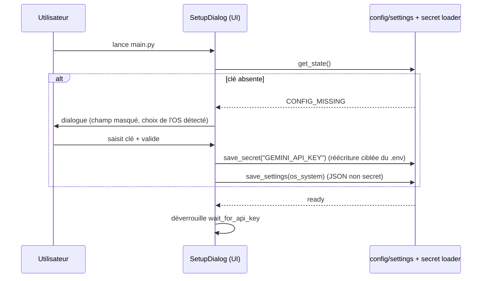
Repli : écriture `.env` impossible (droits) → message explicite + proposition de définir `GEMINI_API_KEY` dans l'environnement ; l'application reste utilisable pour la session (clé en mémoire uniquement, jamais écrite ailleurs).
Erreurs V1 : `.env` verrouillé, clé de moins de 15 caractères (seuil déjà utilisé par `config_manager.is_configured`), `os_system` invalide → rejet avec message.

**[V1.5]** Le premier démarrage devient un assistant de choix de mode (cloud / local / mixte) : voir F-02.

---

## F-02 — Configuration des providers et des clés **[V1.5]** (V1 : Gemini seul)

**[ACTUEL]** Une seule clé (Gemini). Modèle codé en dur (`LIVE_MODEL` dans `core/utils.py`).

**[V1.5, P10–P13]**
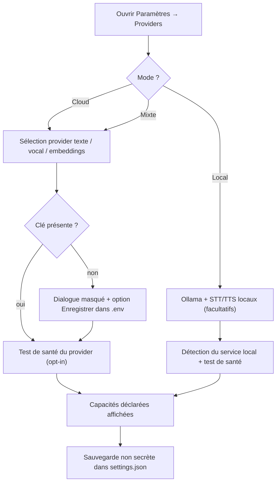
Règles : la clé est stockée par **référence** (`SecretRef`, `BACKEND_SCHEMA.md` §Provider) ; l'UI ne ré-affiche jamais la clé ; rotation = remplacement ; effacement = suppression de la ligne ; aucun provider n'est marqué « capable » de voix/outils sans le déclarer.
Erreurs : clé invalide (`AUTH_FAILED`), quota (`RATE_LIMITED`), service local injoignable (`PROVIDER_UNAVAILABLE`), capacité manquante (`PLATFORM_UNSUPPORTED`/`CAPABILITY_MISSING`). Repli : conserver la configuration précédente valide ; proposer un autre provider si la politique de repli l'autorise.

---

## F-03 — Démarrage sans provider cloud configuré **[V1 partiel, V1.5 complet]**

**[ACTUEL]** Pas de cloud ⇒ pas de JARVIS (écran de configuration, puis attente indéfinie).
**[V1]** Démarrage de l'UI en état `NOT_CONFIGURED` : HUD visible, journal « SYS: clé manquante », saisie de commande désactivée avec explication, dialogue de configuration accessible ; pas de stacktrace, pas de thread zombie.
**[V1.5]** Le routeur évalue les providers disponibles : si un provider **local** est configuré, JARVIS démarre en mode local (F-04) sans exiger de clé cloud ; sinon état `NO_PROVIDER` avec guide d'installation.
Erreurs : aucun provider disponible → refus explicite, aucun repli silencieux vers le cloud (confidentialité).

---

## F-04 — Démarrage avec provider local **[V1.5, P11–P12]**

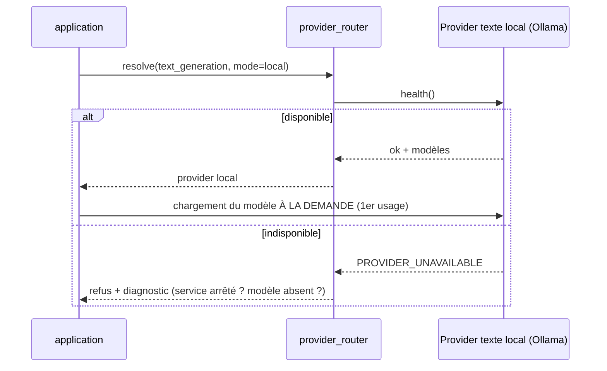
Contraintes : modèles locaux facultatifs, chargés au premier usage ; **vérification RAM/GPU avant chargement** (avertissement si insuffisant) ; pas de voix temps réel locale supposée : si STT/TTS locaux absents, la conversation est **texte uniquement** et l'UI l'indique.

---

## F-05 — Conversation textuelle

**[ACTUEL]** `MainWindow._send()` (champ « Type a command or question… ») journalise `You: …` puis lance `on_text_command` dans un thread → `JarvisLive._on_text_command` → `session.send_client_content(turns, turn_complete=True)` via `run_coroutine_threadsafe`. La réponse arrive en **audio + transcription** (`response_modalities=["AUDIO"]`) : il n'existe pas de réponse textuelle seule.
| Erreur | Comportement actuel |
|---|---|
| Pas de session (`not self._loop or not self.session`) | Commande **perdue silencieusement** |
| Fichier déposé | `ui.current_file` utilisé comme `file_path` par défaut pour `file_processor` |

**[V1, P4]** Si pas de session : message UI « Pas de connexion — commande non envoyée » (et file d'attente de 1 commande, si validé). Test avec session factice.
**[V1.5]** Texte via le provider texte du routeur (réponse textuelle possible, streaming) ; la voix devient un canal optionnel ; commandes texte et voix partagent la même boucle de traitement.

---

## F-06 — Conversation vocale temps réel

**[ACTUEL]** (`JarvisLive.run`) : connexion → 6 tâches (`TaskGroup`) : micro (16 kHz mono int16, blocs de 1024) → file `out_queue(10)` → `send_realtime_input` ; réception : `response.data` → `audio_in_queue` → lecture 24 kHz ; transcriptions agrégées jusqu'à `turn_complete`, puis journal `You:` / `Jarvis:` ; pendant que JARVIS parle (`_is_speaking`) **le micro n'est pas transmis** (pas d'interruption par la voix) ; F4 coupe le micro (`MUTED`).
Chaîne d'états HUD : `INITIALISING → THINKING (connexion) → LISTENING → SPEAKING ↔ LISTENING`, `THINKING` pendant un outil, `ERROR` après échec fatal.

| Erreur | Comportement actuel |
|---|---|
| Erreur transitoire | reconnexion : attente `min(3×n, 30)` s, jusqu'à 5 essais ; compteur remis à 0 à chaque connexion réussie |
| Erreur d'auth/permission/argument invalide | arrêt, état `ERROR` |
| Micro indisponible | exception dans `_listen_audio` → le `TaskGroup` s'arrête → traité comme transitoire (boucle de reconnexion inutile) |
| Outil long | **la réception audio est suspendue** jusqu'à la fin de l'outil |
| Reconnexion | `hotkey_listener.start()` rappelé → raccourcis dupliqués |

**[V1, P4]** Outils en tâches détachées ; arrêt propre des tâches avant reconnexion ; écouteur de raccourci idempotent ; « micro indisponible » = erreur fatale utilisateur (message : vérifier le périphérique) ; `session_resumption` à évaluer par test d'intégration opt-in.
**[V1.5, P10/P12]** `RealtimeVoiceProvider` (C-05) avec capacités déclarées (`audio_in`, `audio_out`, `transcription`, `tool_calls`, `interruptions`) ; interruption (« barge-in ») supportée si la capacité est déclarée, sinon documentée.

---

## F-07 — Transcription et synthèse **séparées** **[V1.5, P12]**

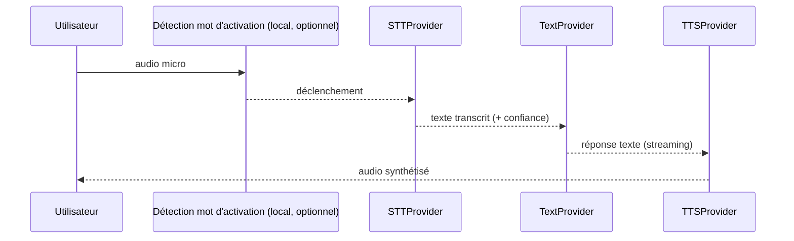
Utilisé quand le provider vocal temps réel est absent ou non souhaité (ex. mode local). Erreurs : STT indisponible → bascule entrée texte ; TTS indisponible → réponse affichée en texte ; latence > seuil → indicateur `THINKING` prolongé + journal. Aucune conservation audio par défaut.

---

## F-08 — Appel d'un outil

**[ACTUEL]** Voir `TRD.md` §4.1. Étapes : `response.tool_call` → pour chaque appel `_execute_tool` → `THINKING` → branche `if/elif` → `run_in_executor` → `result = r or "Done."` → `FunctionResponse` → `send_tool_response`. Exceptions : `result = "Tool 'x' failed: …"` + `speak_error` (journal `ERR:` + message vocal « Sir, … encountered an error »). `save_memory` : traité avant le `try` (aucune validation). `screen_process` : thread daemon, résultat fixe « Stay completely silent ». `shutdown_jarvis` : `os._exit(0)`.

| Erreur | Comportement actuel |
|---|---|
| Outil inconnu | `"Unknown tool: …"` |
| Paramètre manquant | laissé à chaque action (messages libres) |
| Action qui « réussit » sans effet | impossible à détecter (`"Done."`) |

**[V1, P3]**
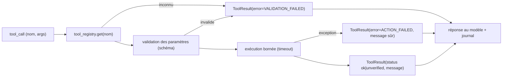
**[V1.5, P13–P14]** Entre la validation et l'exécution s'insèrent : **permission** (niveau de risque × niveau d'autonomie), **confirmation** (F-10), puis **vérification** d'effet (F-14, F-15) avant d'annoncer le succès.

---

## F-09 — Planification d'une tâche composée de plusieurs étapes

**[ACTUEL]** L'outil `agent_task(goal, priority)` → `get_queue().submit(...)` (le prompt n'autorise `agent_task` que « si l'utilisateur le demande explicitement et pour 3+ étapes »). Worker (1 tâche à la fois) → `AgentExecutor.execute` → `create_plan` (Gemini flash-lite, ≤ 5 étapes JSON) → pour chaque étape : `_inject_context` (injection + traduction de contenu pour `file_controller write`), `_call_tool` (16 branches), tentatives ≤ 3 (en pratique 2, R-O12), `analyze_error` → `RETRY/SKIP/REPLAN/ABORT`, `replan` (≤ 2 fois), résumé final vocalisé.

| Erreur | Comportement actuel |
|---|---|
| JSON de plan invalide / erreur modèle | plan de repli : une recherche web du `goal` |
| Outil non reconnu par `_call_tool` (ex. `file_processor`) | `ValueError` → traité comme échec d'étape |
| Abandon (`ABORT`) ou échec après replans | l'exécuteur **retourne une chaîne** ; `TaskQueue` marque `COMPLETED` |
| Étape « skippée » | comptée comme réussie ; résumé « All done » |
| Annulation | `cancel_flag` testé entre étapes et entre tentatives |

**[V1, P5]** Statuts corrects (`FAILED`, `ABORTED`, `PARTIAL`) ; 3 tentatives réelles ; résumé final honnête (liste des étapes `ok/skipped/failed`) ; les outils connus du planificateur sont dérivés du **registre** (plus de deuxième liste) ; la règle « étapes indépendantes » est **reformulée** : les résultats ne sont transmis que par `_inject_context` documenté (comportement existant conservé), le contrat de dépendance typé arrive en V1.5.
**[V1.5, P15]**
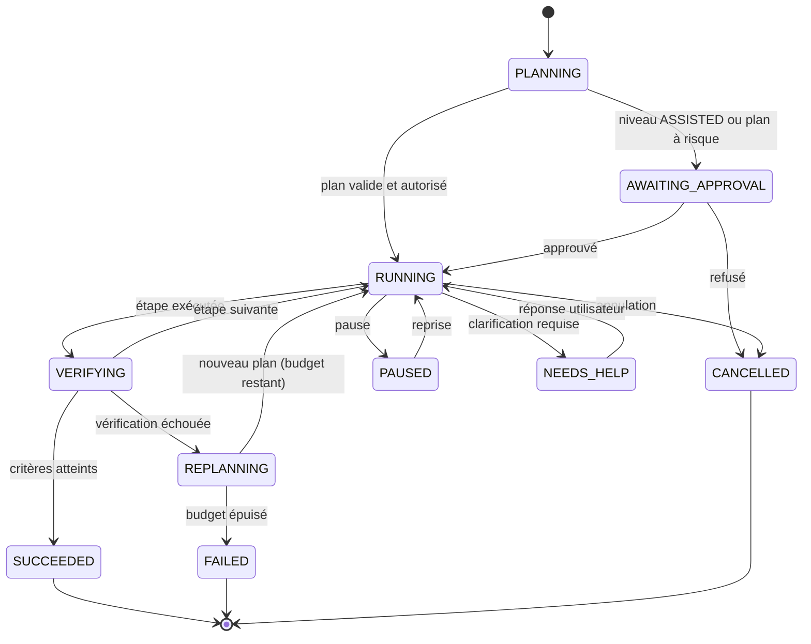
Les étapes déclarent `produces`/`consumes` (valeurs typées) ; budgets de temps, tentatives, replanifications et appels modèle ; l'état est persisté (`TaskState`) pour reprise après redémarrage.

---

## F-10 — Confirmation d'une action sensible

**[ACTUEL]** Aucune confirmation n'est appelée. Existant non branché : `ScreenOverlay.confirm_action(...)` (fenêtre Tk 340×110, bouton Confirmer/Annuler, délai) et `app_profiles.json → privacy.confirm_critical_actions: true` (jamais lu). Le prompt demande de **ne pas** demander confirmation pour les tâches simples.
**[V1, P7]** *Stopgap minimal* : `send_message`, `file_controller delete`, `system_optimizer kill_process` et `computer_settings` d'alimentation passent par une confirmation modale réutilisant le dialogue existant (ou une boîte Qt) ; refus ⇒ `ToolResult(error=CONFIRMATION_DECLINED)` ; délai d'expiration = refus. Cette confirmation est **remplacée** en V1.5 (pas de logique de risque nouvelle en V1).
**[V1.5, P13]**
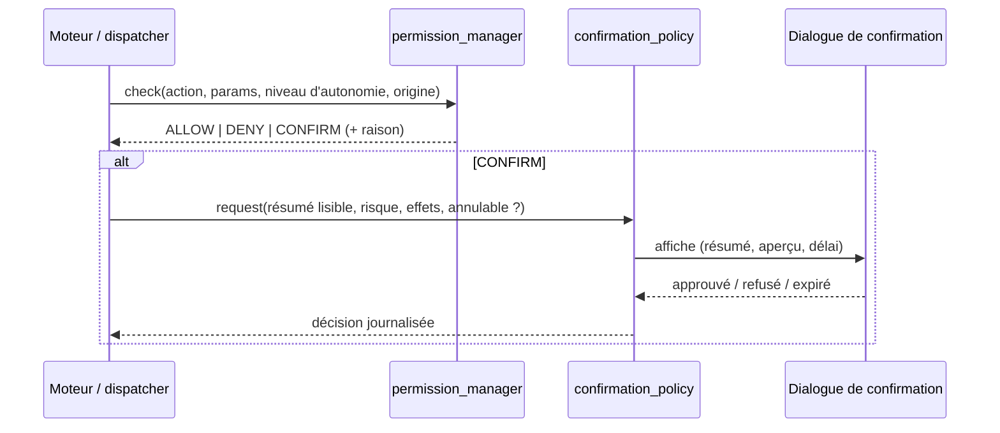
Règles : le texte affiché est **généré par le système** à partir des paramètres validés (jamais le texte brut du modèle) ; l'origine (`user`, `autonomy`, `notification`) est affichée ; expiration = refus ; toute décision est journalisée.

---

## F-11 — Reprise après une erreur

**[ACTUEL]** Voir F-09 (analyse LLM, retry, skip, replan, fix). Au niveau Live : reconnexion (F-06).
**[V1]** Erreurs vocalisées sans détails techniques ; les erreurs de tâches sont consignées avec leur code (`ErrorCode`).
**[V1.5]** Politique de reprise déclarative par action (`RetryPolicy`, `BACKEND_SCHEMA.md`) : erreurs **transitoires** (timeout, verrou, réseau) → réessai avec attente progressive ; erreurs de **validation** → replanification ; erreurs de **permission** → demande d'aide, jamais de contournement ; échec de vérification → réessai d'une autre stratégie documentée, puis arrêt honnête. Le moteur annonce « je n'ai pas pu… » plutôt qu'un succès non prouvé.

---

## F-12 — Annulation ou arrêt d'une tâche

**[ACTUEL]** `TaskQueue.cancel(task_id)` (positionne `cancel_flag`, statut `CANCELLED`) existe mais **aucun outil ni bouton ne l'expose** ; l'outil `agent_task` ne permet que de soumettre. Arrêt global : `shutdown_jarvis` ou fermeture de la fenêtre.
**[V1, P5]** Exposition de l'annulation : paramètre `action=cancel|status|list` **ajouté à `agent_task`** (changement de contrat documenté, rétro-compatible : `goal` reste requis uniquement pour `submit`) ; tâches annulées retirées de la file.
**[V1.5, P15/P19]** Bouton « Stop » dans l'UI + commande vocale ; arrêt coopératif (`CancelToken`) propagé aux outils ; arrêt d'urgence (`kill switch`) qui coupe l'autonomie (`OFF`) et annule toutes les tâches ; l'état final est journalisé et annoncé.
Erreurs : outil non interruptible (ex. frappe clavier en cours) → fin de l'étape courante puis arrêt, signalée comme telle.

---

## F-13 — Utilisation du navigateur

**[ACTUEL]** `browser_control` (Playwright asynchrone, `launch_persistent_context` sur le **profil réel** du navigateur choisi, 14 paramètres : go_to, search, click, type, scroll, get_text, press, close, …) ; `BrowserInspector` (CDP `localhost:9222`, nécessite un navigateur lancé avec `--remote-debugging-port=9222`) ; `web_search` (DDGS) pour la recherche sans navigateur.
| Erreur | Comportement actuel |
|---|---|
| Navigateur absent / profil verrouillé | exception → `"Tool failed"` |
| Contenu de page piégé | texte renvoyé au modèle **tel quel** |
| Saisie dans un champ mot de passe | non bloquée |

**[V1, P7]** Documenter le risque du profil réel ; paramètre pour profil dédié (`jarvis` existant dans le code, vérifié) ; `get_text` renvoie le contenu entouré du marqueur `untrusted`.
**[V1.5, P14/P16]** Profil dédié par défaut ; domaines et champs sensibles bloqués ; vérification : après `go_to`, l'URL/titre attendus ; après `click`, changement observable (DOM ou URL) ; les secrets de connexion ne sont jamais exposés par l'inspection.
**Workflow de référence W-1** : « Recherche X puis résume » = `web_search` → lecture de 2 sources → synthèse ; critère : sources citées, aucune action sur le profil réel.

---

## F-14 — Contrôle d'applications et gestion de fichiers

**[ACTUEL]**
- Applications : `open_app` (alias OS, `shutil.which`, `shell=True`), `computer_control` (clavier/souris/recherche visuelle `screen_find`/`screen_click`), `computer_settings` (volume, luminosité, wifi, fermeture d'apps, alimentation…), `interact_ui` (clic/saisie par coordonnées avec aperçu `ScreenOverlay` et `ActionVerifier`).
- Fichiers : `file_controller` (racine autorisée `~`, suppression via corbeille, dossiers utilisateur protégés, lecture limitée à 4 000 caractères) ; `file_processor` (formats documents) ; `desktop_control` (fond d'écran, rangement, `task` par code généré).

| Erreur | Comportement actuel |
|---|---|
| Application non trouvée | message libre ; aucune preuve d'ouverture |
| Chemin hors `~` | `Access denied` |
| Écran inchangé après action | `ActionVerifier` retourne `False` (sans nouvelle tentative faute de `fallback_fn`) |

**[V1, P7]** `open_app` : lancement **sans shell** (liste d'arguments) ; `desktop_control(task)` : exécution de code généré **désactivée** par défaut (drapeau explicite) ; `ActionLogger` ne stocke plus les valeurs tapées.
**[V1.5, P14/P16]** Chaque action déclare **comment vérifier** : `open_app` → processus/fenêtre attendus ; `file_controller` → existence/taille/hash du fichier ; `computer_settings` → lecture de l'état résultant. Workflows de référence :
- **W-2** « Ouvre le Bloc-notes et écris… » : fenêtre active + contenu lu par l'arbre d'accessibilité.
- **W-3** « Crée le fichier X sur le Bureau » : fichier existant + contenu égal.
- **W-4** « Déplace/organise … » : liste avant/après, corbeille pour les suppressions, confirmation au-delà d'un seuil de fichiers.
- **W-5** « Règle le volume à N % » : lecture de la valeur après réglage.
Repli : si la vérification est impossible, statut `unverified` annoncé comme tel.

---

## F-15 — Rédaction, confirmation et envoi d'un message

**[ACTUEL]** `send_message(receiver, platform, message_text, …)` : avant l'envoi, `JarvisLive` appelle **automatiquement** `get_context` (capture de l'historique par GUI : ouverture de l'application, recherche du contact, sélection/copie) ; puis `send_message` (ouverture de l'app, recherche, collage, Entrée). `reminder`/notifications peuvent déclencher le même chemin (F-16). Support média/audio via `send_message_utils` (gTTS/pyttsx3, pydub).
| Erreur | Comportement actuel |
|---|---|
| Mauvais contact sélectionné | non détecté (temporisations fixes, frappe aveugle) |
| Application absente | `_open_app` échoue → message libre |
| Message issu d'une notification | **aucune confirmation** ; contenu de la notification pilote la réponse (R-O07) |

**[V1, P7]**
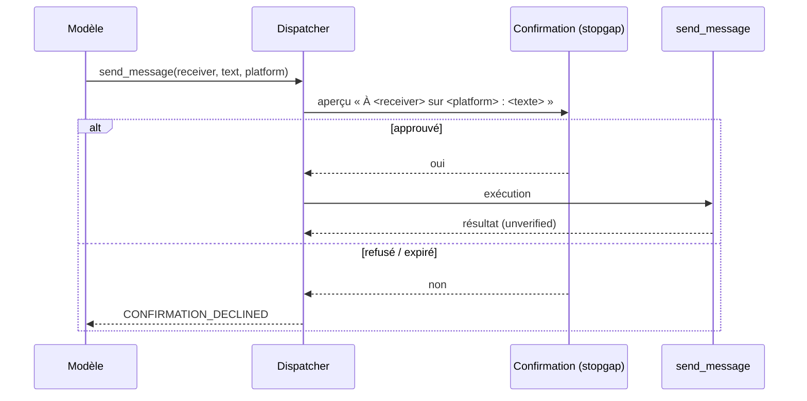
`auto_reply_enabled` passe à `false` par défaut ; une notification n'est **jamais** une instruction.
**[V1.5, P14/P16]** Brouillon → confirmation (niveau selon autonomie) → envoi → **vérification** (le message apparaît dans la conversation, par lecture de l'arbre d'accessibilité ou capture) → statut `verified | unverified`. Les messages entrants sont étiquetés `untrusted`. `AUTONOMOUS` n'autorise l'envoi sans confirmation que pour des destinataires/plateformes **explicitement listés** (liste blanche), jamais par défaut.

---

## F-16 — Mode d'autonomie

**[ACTUEL]** L'outil `manage_autonomy` (`enable/disable/status/set_sensitivity`) agit sur `AutonomyManager.enabled/sensitivity`. **Aucun effet** : aucun agent enregistré, aucune idée soumise, drapeau non lu hors code mort ; `_context_awareness_loop` désactivée. Les seules actions « proactives » réelles : réponse aux **notifications** (F-15) et partage d'écran (F-19).
**[V1, P5/P7]** L'état « expérimental, sans effet » est documenté dans la déclaration d'outil et dans les journaux ; le modèle ne peut plus **activer** l'autonomie sans confirmation utilisateur.
**[V1.5, P13/P15]** Niveaux (contrat C-13) :

| Niveau | Comportement |
|---|---|
| `OFF` | Aucune tâche proactive ; les demandes explicites restent soumises aux permissions normales |
| `ASSISTED` | JARVIS **propose** et prépare un plan ; rien ne s'exécute sans validation du plan |
| `SUPERVISED` | Exécute les actions de risque `LOW`/`MEDIUM` autorisées ; confirmation des `HIGH` |
| `AUTONOMOUS` | Exécute les actions expressément autorisées dans un **périmètre défini** (listes d'outils/chemins/destinataires), avec budgets, journal, bouton d'arrêt ; confirmation **obligatoire** des `CRITICAL` ; interdictions fondamentales inchangées |

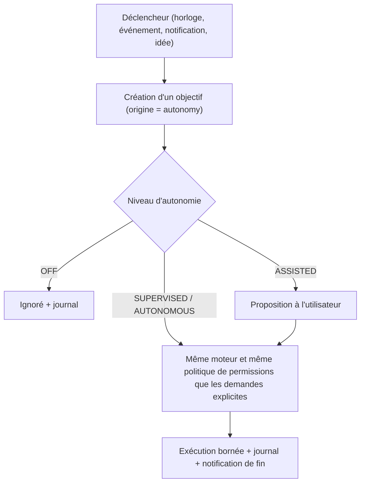
Arrêt immédiat : bouton/commande « stop » → `OFF` + annulation. Erreurs : budget dépassé → arrêt et rapport ; permission refusée → demande d'aide.

---

## F-17 — Récupération de la mémoire

**[ACTUEL]** Au (re)démarrage de session, `_build_config()` appelle `load_memory()` puis `format_memory_for_prompt()` (≤ 2 000 caractères ; limites par catégorie : 15 préférences, 8 projets, 10 relations…) et l'injecte dans l'instruction système, avec l'heure courante et la configuration des notifications. Écriture : outil `save_memory(category, key, value)` → `update_memory`. Les `USER_*.md` sont **régénérés** à chaque sauvegarde (jamais relus). Pas de recherche à la demande.
| Erreur | Comportement actuel |
|---|---|
| Fichier JSON corrompu | mémoire vide silencieuse ; risque d'écrasement de `.bak` (R-O13) |
| Dépassement 8 000 caractères | suppression des plus anciennes entrées, signalée seulement par un `print` console |
| Mémoire modifiée en cours de session | non visible avant la prochaine connexion |

**[V1, P6]** Lecture robuste (corruption → restauration depuis `.bak` + avertissement UI) ; écriture atomique sous verrou unique ; catégorie validée ; élagage **journalisé** (liste des clés supprimées) ; test de charge concurrente.
**[V1.5, P17]** `MemoryService.search(query, scope, limit)` appelé par le moteur avant la construction du contexte ; résultat = entrées + sources + scores ; l'injection au prompt est un **résumé borné** ; suppression/correction par commande (« oublie X »). Flux : question → récupération structurée (préférences/projets) → récupération épisodique → contexte assemblé avec provenance.

---

## F-18 — Indexation et recherche RAG **[V1.5, P18]**

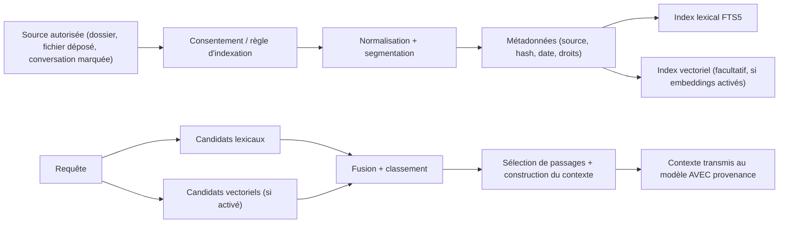
Règles : **rien n'est indexé sans règle explicite** (dossiers autorisés) ; aucun envoi d'embeddings vers un service distant sans accord explicite (mode `local` par défaut) ; mise à jour = hash de contenu ; suppression d'une source ⇒ suppression de ses segments et vecteurs ; l'audio, les captures d'écran et les messages ne sont **pas** indexés par défaut.
Erreurs : format illisible → source marquée `FAILED` avec raison ; index corrompu → reconstruction depuis les sources ; embeddings indisponibles → repli sur lexical seul (annoncé).

---

## F-19 — Partage d'écran, confidentialité et arrêt

**[ACTUEL]**
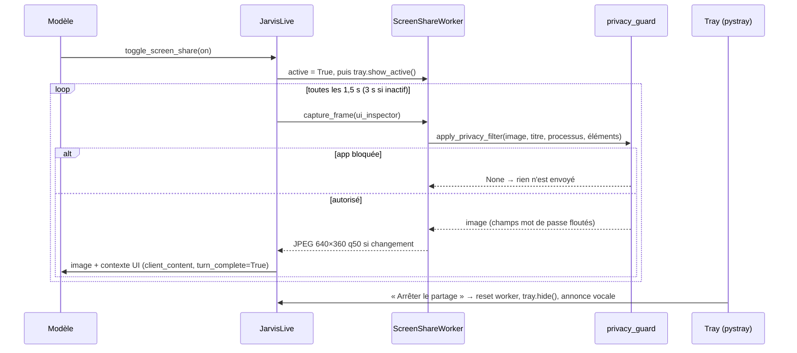
Blocage par défaut : keepass, 1password, bitwarden, lastpass, signal ; titres contenant mot de passe/password/authentification/code pin/2fa… (`config/app_profiles.json`). Le raccourci Ctrl+Shift+J envoie une zone 400×400 haute qualité autour du curseur **sans** filtre ; `screen_process` (vision/caméra) est une **session Live séparée** sans filtre.
| Erreur | Comportement actuel |
|---|---|
| `mss`/`PIL` absents | pas de capture (silencieux) |
| Exception de capture | journal console, boucle continue |
| Envoi de contexte UI | déclenche un **tour de modèle** à chaque cycle (coût/latence, R-O15) |

**[V1, P7]** `turn_complete=False` pour le contexte UI **si** validé par test d'intégration ; filtre de confidentialité appliqué à `hotkey` et `screen_process` (réutilisation de `privacy_guard` sans nouvelle architecture) ; icône de zone de notification **toujours** visible pendant une capture ; arrêt immédiat vérifié par test.
**[V1.5, P16]** Pipeline de capture unique `perception/screen_capture` (filtre universel, journal de chaque capture : horodatage + app, **sans contenu**) ; politique de rétention : aucune persistance d'image par défaut.

---

## F-20 — Absence de réseau ou indisponibilité d'un provider

**[ACTUEL]** `run()` : toute erreur non fatale → reconnexion bornée (5 essais, message UI « Reconnecting in Ns »), puis « Please restart JARVIS » et état `ERROR`. Les modules d'agent (planificateur, erreurs, `code_helper`, `dev_agent`) échouent individuellement (replis : plan « web_search », décision `REPLAN`). Les outils réseau (`web_search`, `weather_report`, `youtube_video`, `flight_finder`) retournent des messages libres.
**[V1, P4/P5]** Distinction explicite `NETWORK_DOWN` / `AUTH_FAILED` / `RATE_LIMITED` ; état UI dédié « HORS LIGNE » ; réessai avec attente progressive plafonnée, **sans** relancer d'actions déjà exécutées ; les outils **locaux** (fichiers, applications, réglages) restent utilisables par commande texte lorsque c'est possible (V1.5 pour la voix).
**[V1.5, P11]** Politique de repli du routeur : `fallback = none | local | cloud` configurable ; un repli **vers le cloud** n'est jamais implicite si le mode est `local`/confidentiel ; message honnête : « le provider X est indisponible ; je passe sur Y » ou « je ne peux pas traiter ceci hors ligne ».

---

## F-21 — Fermeture propre de JARVIS

**[ACTUEL]** `shutdown_jarvis` : journal, annonce « Goodbye, sir. », puis `os._exit(0)` après 1 s (aucun nettoyage : tâches, icône tray, écouteurs, `TaskQueue`, écritures en cours). Fermeture de la fenêtre : la boucle Qt s'arrête, le thread daemon est tué. `AutonomyManager.stop()` est appelé dans le `finally` de `run()` seulement en cas de sortie de boucle.
**[V1, P4]**
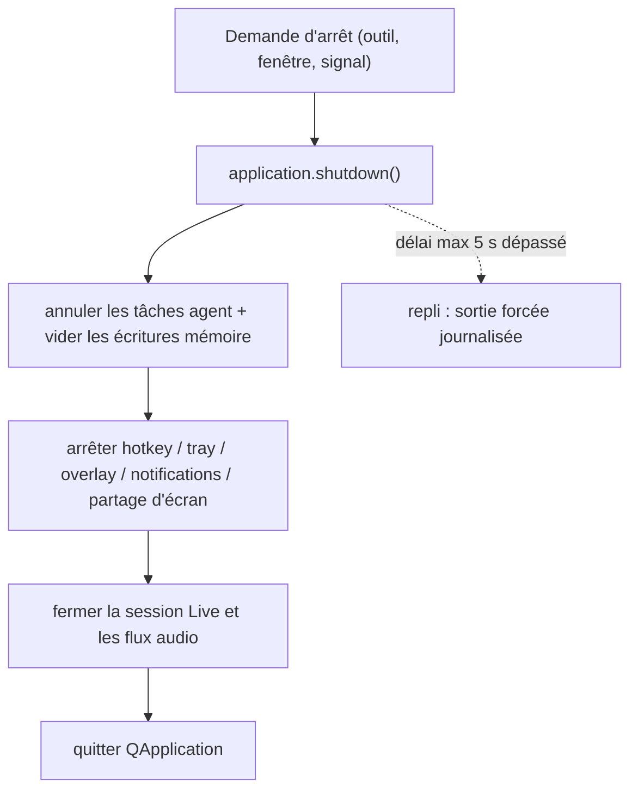
Critères : aucune donnée mémoire perdue ; icône de zone de notification retirée ; code de sortie 0.
**[V1.5, P15/P19]** Arrêt du moteur : tâches en cours sauvegardées (`PAUSED`) pour reprise au prochain démarrage (selon réglage) ; journal de fermeture.

---

## Annexe A — Matrice flux × phases

| Flux | V1 (phases) | V1.5 (phases) |
|---|---|---|
| F-01, F-03 | P0, P1, P8 | P10, P19 |
| F-02, F-04 | — | P10, P11, P13, P19 |
| F-05, F-06 | P4 | P10, P12 |
| F-07 | — | P12 |
| F-08 | P3 | P13, P14 |
| F-09, F-11, F-12 | P5 | P15 |
| F-10 | P7 (stopgap) | P13 |
| F-13, F-14, F-15 | P7 | P14, P16 |
| F-16 | P5, P7 (documentation + garde) | P13, P15 |
| F-17 | P6 | P17 |
| F-18 | — | P18 |
| F-19 | P7 | P16 |
| F-20 | P4, P5 | P11 |
| F-21 | P4 | P15, P19 |

## Annexe B — Légende des états HUD (existants)

`INITIALISING`, `THINKING`, `PROCESSING`, `LISTENING`, `SPEAKING`, `MUTED`, `ERROR`. États **à ajouter en V1** : `NOT_CONFIGURED`, `OFFLINE`. États **à ajouter en V1.5** : `AWAITING_CONFIRMATION`, `AUTONOMY_<niveau>` (badge), `TASK_RUNNING`. Voir `DESIGN_SYSTEM.md`.
