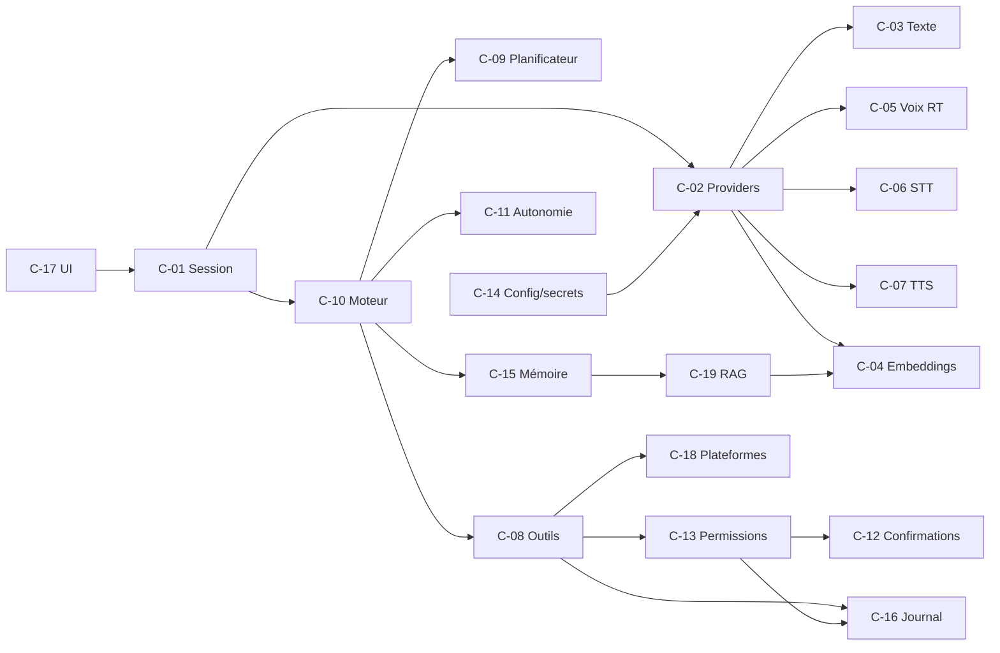

# BACKEND_CONTRACT — Contrats entre composants du moteur local de JARVIS

| | |
|---|---|
| **Document** | `BACKEND_CONTRACT.md` (7/9) |
| **Périmètre** | « Backend » = **le moteur local de l'application de bureau** (aucun serveur distant n'est supposé) |
| **Base** | `main` @ `2dbb971` |
| **Types** | Les structures (`ToolSpec`, `ToolResult`, `TaskState`, …) sont définies **une seule fois** dans `BACKEND_SCHEMA.md` ; ce document y renvoie par nom |
| **Python** | ≥ 3.11 ; `Protocol`, `dataclasses`, `enum.StrEnum` (ADR-023) |

**Statut de chaque contrat** : **[ACTUEL]** = forme existante dans le code ; **[V1]** = forme de transition créée pendant la stabilisation ; **[CIBLE V1.5]** = n'existe pas. Un contrat « CIBLE V1.5 » ne doit pas être présenté comme implémenté.

**Conventions communes**
- Toute méthode susceptible de bloquer est soit `async`, soit documentée comme *appel bloquant à exécuter hors boucle* ; aucune méthode ne bloque la boucle de réception audio.
- Toute opération longue accepte un **délai** (`timeout_s`) et un **jeton d'annulation** (`CancelToken`, V1.5 ; en V1 : `threading.Event`).
- Les erreurs sont des `ToolError`/`JarvisError` portant un `ErrorCode` (`BACKEND_SCHEMA.md` §ErrorCode) ; jamais une chaîne libre en guise d'erreur ; jamais de secret dans un message.
- Un résultat n'est `ok` que s'il est étayé : `verification ∈ {verified, unverified, not_applicable}`.

**Index** : C-01 Session · C-02 AIProvider (registre, capacités, routeur) · C-03 TextProvider · C-04 EmbeddingProvider · C-05 RealtimeVoiceProvider · C-06 STTProvider · C-07 TTSProvider · C-08 Registre et exécution d'outils · C-09 Planificateur · C-10 Tâche et moteur · C-11 Autonomie · C-12 Confirmations · C-13 Permissions et niveaux d'autonomie · C-14 Configuration et secrets · C-15 Mémoire structurée · C-16 Journalisation et audit · C-17 Interface et événements UI · C-18 Adaptateurs de plateforme · C-19 Récupération RAG.

**Graphe de relations**



---

## C-01 — Gestionnaire de session

**Statut** : [ACTUEL] `JarvisLive.run` (reconnexion, boucles) · [V1] `core/session_manager.py` · [CIBLE V1.5] pilote un `RealtimeVoiceProvider` (C-05) ou la chaîne STT/TTS.

**Responsabilités** : ouvrir/fermer la session avec le provider vocal ; démarrer et superviser les boucles de fond (audio, notifications, partage d'écran) ; classifier les erreurs ; reconnecter de façon bornée ; exposer l'état à l'UI (C-17) ; arrêt propre.

```python
# SessionState, Origin : définis dans BACKEND_SCHEMA.md (§10, §2.4)
class SessionManager(Protocol):
    async def run(self) -> None: ...                 # boucle de vie ; retourne à l'arrêt ou sur erreur fatale
    async def send_text(self, text: str, *, origin: Origin = Origin.USER) -> None: ...
    async def shutdown(self, *, grace_s: float = 5.0) -> None: ...
    @property
    def state(self) -> SessionState: ...
```

| Aspect | Contrat |
|---|---|
| Entrées | configuration provider (C-14), `UiPort`/événements (C-17), registre d'outils (C-08) |
| Sorties | événements d'état (`UiEvent.StateChanged`), journal (C-16) |
| Erreurs | `AUTH_FAILED`, `PERMISSION_DENIED`, `CONFIG_MISSING` = **fatales** (aucune reconnexion) ; `NETWORK_DOWN`, `PROVIDER_UNAVAILABLE`, `RATE_LIMITED` = transitoires |
| Asynchrone | une seule boucle `asyncio` propriétaire ; `TaskGroup` ; une tâche qui échoue annule les autres puis déclenche la politique de reconnexion |
| Reconnexion | ≤ 5 tentatives, attente `min(3×n, 30)` s (comportement actuel conservé) ; compteur remis à zéro après connexion réussie |
| Délais | connexion : 30 s ; arrêt coopératif : `grace_s` (5 s) puis repli forcé **journalisé** |
| Annulation | `shutdown()` annule outils/tâches en cours, ferme flux audio et session |
| Sécurité | aucun secret en logs ; le contenu entrant (audio/transcription) est une **donnée** |
| Limites | micro : file bornée (`maxsize=10` actuel) avec politique « supprimer le plus ancien » documentée |
| Relations | C-02/C-05 (provider), C-08 (outils appelés par le modèle), C-17 (UI), C-16 |

Comportements **à ne pas régresser** : pendant que JARVIS parle, le micro n'est pas transmis (V1) ; F4 coupe le micro ; transcriptions `You:`/`Jarvis:` consignées à `turn_complete`.

---

## C-02 — Fournisseur IA (base, capacités, registre, routeur) — [CIBLE V1.5]

**Responsabilités** : décrire **ce qu'un provider sait réellement faire** ; permettre sélection et repli sans que la logique métier connaisse les SDK.

```python
# Capability, ProviderKind, ProviderCapabilities : BACKEND_SCHEMA.md §6.1
class AIProvider(Protocol):
    id: str                                  # ex. "gemini", "ollama"
    kind: ProviderKind                       # CLOUD | LOCAL
    def capabilities(self) -> ProviderCapabilities: ...
    async def health(self) -> HealthStatus: ...          # sans effet de bord, délai court
    async def close(self) -> None: ...

class ProviderRegistry(Protocol):
    def register(self, provider: AIProvider) -> None: ...
    def get(self, provider_id: str) -> AIProvider: ...
    def with_capability(self, cap: Capability) -> list[AIProvider]: ...

class ProviderRouter(Protocol):
    def resolve(self, request: RoutingRequest) -> RoutingDecision: ...   # lève CAPABILITY_MISSING / PROVIDER_UNAVAILABLE
```

| Aspect | Contrat |
|---|---|
| Entrées | `RoutingRequest` : capacités requises, `mode` (`cloud/local/mixed`), `privacy` (`allow_remote: bool` **par capacité**), `fallback` (`none/local/cloud`), contraintes de coût/latence |
| Sorties | `RoutingDecision` : provider choisi, raison, replis possibles, avertissements (ex. « mode local : voix temps réel indisponible, texte uniquement ») |
| Règles | dispo → configuration/clé présente → capacités requises → mode → confidentialité → coût/limites connus → replis autorisés ; **jamais** d'inférence de capacité ; **jamais** de repli vers le cloud si `allow_remote=False` |
| Erreurs | `CAPABILITY_MISSING`, `PROVIDER_UNAVAILABLE`, `AUTH_FAILED`, `CONFIG_MISSING` |
| Sécurité | les clés ne transitent que par `SecretRef` (C-14) ; aucune donnée personnelle envoyée sans `allow_remote` |
| Limites | `ProviderCapabilities` inclut limites connues (taille de contexte, débit, coût indicatif) — champs optionnels ; **inconnu = non supposé** |
| Relations | C-03…C-07 (sous-contrats), C-14, C-01 |

---

## C-03 — Fournisseur de génération de texte — [CIBLE V1.5] (aujourd'hui : appels directs `google.generativeai`)

**Usages actuels à couvrir** : plan JSON (`agent/planner.py`, `gemini-2.5-flash-lite`/`flash`), décision d'erreur JSON (`error_handler`), génération de code (`code_helper`, `dev_agent`, `desktop`), traduction/détection de langue (`executor`), résumé d'étape (`executor._summarize`).

```python
class TextProvider(AIProvider, Protocol):
    async def generate(self, req: TextRequest, *, timeout_s: float = 60, cancel: CancelToken | None = None) -> TextResult: ...
    async def generate_structured(self, req: TextRequest, schema: JsonSchema, *, timeout_s: float = 60) -> dict: ...
    def stream(self, req: TextRequest, *, cancel: CancelToken | None = None) -> AsyncIterator[TextChunk]: ...
    async def call_tools(self, req: TextRequest, tools: Sequence[ToolSpec]) -> ToolCallResult: ...   # seulement si Capability.TOOL_CALLS
```

| Aspect | Contrat |
|---|---|
| Entrées | `TextRequest` (messages, instruction système, température, limites) ; contenu externe **déjà encapsulé** `untrusted` (ADR-016) |
| Sorties | `TextResult` (texte, usage tokens si connu, raison d'arrêt) ; `generate_structured` : JSON **validé** contre le schéma, sinon `VALIDATION_FAILED` (plus de `re.sub` de fences dans les appelants) |
| Erreurs | `RATE_LIMITED`, `TIMEOUT`, `PROVIDER_UNAVAILABLE`, `AUTH_FAILED`, `CAPABILITY_MISSING` (ex. `call_tools` non supporté) |
| Asynchrone | `async` ; adaptateurs synchrones (SDK hérité) exécutent dans un pool borné |
| Délais / annulation | `timeout_s` obligatoire ; annulation coopérative |
| Sécurité | ne retourne jamais de secret ; la sortie du modèle est une **donnée** pour le moteur (jamais exécutée sans C-08) |
| Limites | taille de contexte déclarée ; troncature explicite et signalée |
| Relations | C-09, C-10, outils de code (C-08) |

---

## C-04 — Fournisseur d'embeddings — [CIBLE V1.5]

```python
class EmbeddingProvider(AIProvider, Protocol):
    dimension: int
    async def embed(self, texts: Sequence[str], *, kind: EmbedKind = EmbedKind.DOCUMENT) -> list[list[float]]: ...
```
Isolé de la génération de texte (ADR-005). `kind=QUERY|DOCUMENT` si le modèle le distingue. **Local par défaut** ; un provider distant exige `allow_remote=True` explicite (R-F10). Erreurs : `PROVIDER_UNAVAILABLE`, `CAPABILITY_MISSING` ⇒ repli **lexical** (C-19). Lots bornés (≤ 64 textes/appel), délai par lot. Relations : C-19, C-15.

---

## C-05 — Fournisseur vocal temps réel — [ACTUEL via Gemini Live] / [CIBLE V1.5] contrat abstrait

**Existant** : `client.aio.live.connect(model, config)` ; envoi `send_realtime_input(media=…)` (PCM 16 kHz mono int16 ; JPEG pour la vision) ; réception `session.receive()` → `response.data` (PCM 24 kHz), `server_content.output_transcription / input_transcription / turn_complete`, `response.tool_call` ; `send_tool_response` ; `send_client_content(turns, turn_complete)` pour le texte ; voix « Charon » ; système d'instruction = heure + mémoire + config notifications + `prompt.txt`.

```python
class RealtimeVoiceProvider(AIProvider, Protocol):
    async def open(self, cfg: RealtimeSessionConfig) -> "RealtimeSession": ...

class RealtimeSession(Protocol):
    async def send_audio(self, pcm16: bytes) -> None: ...
    async def send_image(self, jpeg: bytes) -> None: ...                 # si Capability.VISION
    async def send_text(self, text: str, *, end_turn: bool = True) -> None: ...
    async def send_tool_results(self, results: Sequence[ToolResultMessage]) -> None: ...
    def events(self) -> AsyncIterator[RealtimeEvent]: ...                # AudioChunk | Transcript(role, text, final) | ToolCallRequest | TurnComplete | Interrupted | Error
    async def close(self) -> None: ...
```

| Aspect | Contrat |
|---|---|
| Capacités déclarées | parmi `AUDIO_INPUT, AUDIO_OUTPUT, TRANSCRIPTION, TOOL_CALLS, INTERRUPTIONS, VISION` — **uniquement** celles réellement offertes (le contrat n'impose pas les primitives Gemini aux autres fournisseurs) |
| Erreurs | `AUTH_FAILED`/`PERMISSION_DENIED` (fatales), `NETWORK_DOWN`, `RATE_LIMITED`, `PROVIDER_UNAVAILABLE` |
| Asynchrone | `events()` consommé par une unique tâche ; `send_*` non bloquants ; les résultats d'outils peuvent arriver **dans un ordre différent** des appels (identifiants) |
| Délais | ouverture 30 s ; absence d'événement > N s → `TIMEOUT` (valeur à mesurer) |
| Annulation | `close()` idempotent |
| Sécurité | contenu transcrit = **donnée** ; images : filtre de confidentialité **avant** l'envoi (C-17/perception) |
| Limites | version d'API et nom de modèle **dans la configuration** (ADR-022), pas en constante |
| Relations | C-01, C-08, C-14 |

---

## C-06 — Fournisseur STT — [CIBLE V1.5]

```python
class STTProvider(AIProvider, Protocol):
    def transcribe_stream(self, audio: AsyncIterator[bytes], *, language: str | None = None) -> AsyncIterator[SttEvent]: ...  # Partial | Final(text, confidence)
    async def transcribe_file(self, path: Path, *, language: str | None = None) -> SttResult: ...
```
Détection du mot d'activation : `WakeWordDetector.detect(audio_frame) -> bool` (interface séparée, local, optionnelle). Erreurs : `PROVIDER_UNAVAILABLE`, `DEPENDENCY_MISSING`, `TIMEOUT`. **Aucune persistance audio par défaut.** Candidats locaux (non intégrés) : famille Whisper.

## C-07 — Fournisseur TTS — [CIBLE V1.5]

```python
class TTSProvider(AIProvider, Protocol):
    def synthesize_stream(self, text: AsyncIterator[str] | str, *, voice: str | None = None) -> AsyncIterator[bytes]: ...  # PCM
    async def voices(self) -> list[VoiceInfo]: ...
```
Interruptible (annulation coupe la lecture). Erreurs : `PROVIDER_UNAVAILABLE`, `DEPENDENCY_MISSING`. Repli : affichage texte. Candidat local (non intégré) : Piper. Note : l'**actuel** `send_message_utils` utilise `gTTS`/`pyttsx3` pour des **fichiers audio de message** — hors de ce contrat (outil, pas provider de conversation).

---

## C-08 — Registre et exécution d'outils

**Statut** : [ACTUEL] `core/tools.py` (déclarations) + `JarvisLive._execute_tool` (dispatch) + `agent/executor._call_tool` (second dispatch) · [V1] `core/tool_registry.py` + `core/tool_dispatcher.py` · [CIBLE V1.5] `ActionSpec` (contrat d'action) + permissions + vérification.

### C-08a — Registre

```python
@dataclass(frozen=True)
class ToolSpec:                         # voir BACKEND_SCHEMA.md §Outils (forme V1)
    name: str; description: str; parameters: dict            # schéma identique à TOOL_DECLARATIONS
    handler: str                                             # chemin dotté, import tardif
    timeout_s: float = 30.0; planner: bool = False; platforms: frozenset[str] = frozenset({"windows"})

class ToolRegistry(Protocol):
    def register(self, spec: ToolSpec) -> None: ...          # nom unique, sinon erreur
    def get(self, name: str) -> ToolSpec: ...                # KeyError → VALIDATION_FAILED
    def declarations(self) -> list[dict]: ...                # = TOOL_DECLARATIONS (compatibilité)
    def planner_tools(self) -> list[ToolSpec]: ...
```

### C-08b — Exécution

```python
class ToolDispatcher(Protocol):
    async def execute(self, call: ToolCall, ctx: ExecutionContext) -> ToolResult: ...
```
Pipeline **V1** : `get` → validation du schéma → (stopgap C-12 si l'action figure dans la liste de confirmation) → exécution bornée dans un pool → normalisation. Pipeline **V1.5** : `get(ActionSpec)` → validation typée → **C-13 `check`** → (C-12) → exécution → **vérification** (`ActionSpec.verify`) → journal C-16.

| Aspect | Contrat |
|---|---|
| Entrées | `ToolCall(id, name, args, origin)` ; `ExecutionContext` (UI, annulation, budget, tâche/étape) |
| Sorties | `ToolResult` : `status ∈ {ok, unverified, error, declined, cancelled}`, `message` (court, lisible), `data` (structuré optionnel), `error: ErrorCode | None`, `verification`, `duration_ms` ; la réponse au modèle reste `{"result": message}` **plus** `status` en V1 (compatibilité) |
| Erreurs | `VALIDATION_FAILED`, `PERMISSION_DENIED`, `CONFIRMATION_DECLINED`, `TIMEOUT`, `CANCELLED`, `ACTION_FAILED`, `DEPENDENCY_MISSING`, `PLATFORM_UNSUPPORTED`, `VERIFICATION_FAILED` |
| Asynchrone | `execute` est `async` ; handlers synchrones exécutés via pool borné ; **ne jamais** bloquer la boucle audio |
| Délais | `ToolSpec.timeout_s` (défaut 30 s) ; dépassement ⇒ `TIMEOUT` et annulation coopérative |
| Annulation | `CancelToken` propagé ; outil non interruptible : fin de l'étape courante puis `CANCELLED` |
| Sécurité | aucune action sans validation ; paramètres sensibles masqués en logs ; sorties tronquées (≈ 4 000 caractères) |
| Idempotence | déclarée par outil (`ActionSpec.idempotent`) ; un réessai n'est permis que si idempotent ou si l'échec précède tout effet |
| Relations | C-13, C-12, C-16, C-18, C-10 |

### Cartographie des **26 outils** (liste vérifiée par analyse de `core/tools.py` ; chacun a une branche dans `_execute_tool`)

Colonnes : **Vague** = vague de migration de P14 (A lecture, B fichiers/apps, C saisie/écran, D effets externes/code/système) · **Risque cible** (par défaut ; surcharges par action indiquées) · **Vérification cible** (V1.5).

| # | Outil | Handler actuel | Params (req.) | Vague | Risque cible | Effets de bord | Vérification cible | Win |
|---|---|---|---|---|---|---|---|---|
| 1 | `open_app` | `actions/open_app.open_app` | 1 (`app_name`) | B | MEDIUM | lance un processus | processus/fenêtre apparu | oui |
| 2 | `web_search` | `actions/web_search.web_search` | 4 (`query`) | A | LOW | requête réseau | résultats non vides, sources | non |
| 3 | `weather_report` | `actions/weather_report.weather_action` | 1 (`city`) | A | LOW | réseau/navigateur | n/a | non |
| 4 | `send_message` | `actions/send_message.send_message` (+ `get_context` en pré-appel) | 6 (`receiver`, `platform`) | D | **HIGH** (effet externe irréversible) | message envoyé | message visible dans le fil | oui |
| 5 | `get_context` | `actions/get_context.get_context` | 3 (`contact`) | A→C | MEDIUM (lit un fil privé par GUI) | ouverture d'app, sélection/copie | texte récupéré non vide | oui |
| 6 | `reminder` | `actions/reminder.reminder` | 3 (`date`,`time`,`message`) | B | MEDIUM | tâche planifiée OS | tâche existante (`schtasks /Query`) | oui |
| 7 | `youtube_video` | `actions/youtube_video.youtube_video` | 5 (aucun requis) | A | LOW | ouvre le navigateur | onglet/URL attendue | non |
| 8 | `screen_process` | `actions/screen_processor.screen_process` | 2 (`text`) | C | MEDIUM (capture écran/caméra → cloud) | session Live + capture | n/a (réponse) ; filtre confidentialité | non |
| 9 | `computer_settings` | `actions/computer_settings.computer_settings` | 3 | B | MEDIUM ; **HIGH** pour alimentation (arrêt/redémarrage/veille) | réglages système | relecture de l'état | oui |
| 10 | `manage_autonomy` | `actions/manage_autonomy.manage_autonomy` | 4 (`action`) | D | **HIGH** pour `enable`/hausse de niveau ; LOW pour `status`/`disable` | état d'autonomie | relecture de l'état | non |
| 11 | `system_optimizer` | `actions/system_optimizer.system_optimizer` | 6 (`action`) | D | **HIGH** (`kill_process`) ; LOW (lecture) | termine des processus | processus absent | non |
| 12 | `iot_control` | `actions/iot_control.iot_control` | 4 (`action`) | A | LOW (**simulation**) | aucun effet réel | n/a (préfixe « [simulation] ») | non |
| 13 | `browser_control` | `actions/browser_control.browser_control` | 14 (`action`) | C | MEDIUM ; HIGH sur sessions authentifiées | navigation, saisie | URL/DOM attendu | non (Playwright) |
| 14 | `file_controller` | `actions/file_controller.file_controller` | 8 (`action`) | B | LOW (lecture) · MEDIUM (créer/écrire/copier/renommer) · **HIGH** (supprimer/déplacer) | fichiers | existence, taille, hash ; corbeille | non |
| 15 | `desktop_control` | `actions/desktop.desktop_control` | 5 (`action`) | B | MEDIUM ; `task` = **CRITICAL** (désactivé par défaut) | fond d'écran, rangement | liste avant/après | oui |
| 16 | `code_helper` | `actions/code_helper.code_helper` | 8 (`action`) | D | LOW (`explain`) · MEDIUM (`write/edit`) · **HIGH** (`run/build`) | écrit/exécute du code | code de sortie, fichiers | non |
| 17 | `dev_agent` | `actions/dev_agent.dev_agent` | 4 (`description`) | D | **HIGH** (génère, installe, exécute) | projet dans `~/Desktop/JarvisProjects`, `pip install` | exécution du projet | non |
| 18 | `agent_task` | `agent/task_queue.get_queue().submit` | 2 (`goal`) | D | MEDIUM (soumission) ; les **étapes** sont évaluées individuellement | tâche en arrière-plan | statut moteur | non |
| 19 | `computer_control` | `actions/computer_control.computer_control` | 15 (`action`) | C | MEDIUM ; HIGH sur fenêtres sensibles (bloqué par confidentialité) | clavier/souris | changement observable ciblé | oui |
| 20 | `game_updater` | `actions/game_updater.game_updater` | 7 (aucun requis) | B | MEDIUM ; **HIGH** si `shutdown_when_done` | installe/met à jour ; peut éteindre | statut de téléchargement | oui |
| 21 | `flight_finder` | `actions/flight_finder.flight_finder` | 7 (`origin`,`destination`,`date`) | A | LOW | navigateur | n/a | non |
| 22 | `shutdown_jarvis` | branche interne `JarvisLive` | 0 | D | LOW (confirmer si tâches actives) | arrête l'application | processus terminé proprement | non |
| 23 | `file_processor` | `actions/file_processor.file_processor` | 17 (aucun requis) | A | LOW (lecture) · MEDIUM (écriture de sortie) | fichiers de sortie | fichier produit | non |
| 24 | `save_memory` | branche interne → `memory.update_memory` | 3 (`category`,`key`,`value`) | D | LOW (MEDIUM si écrasement) | écrit la mémoire | relecture de l'entrée | non |
| 25 | `toggle_screen_share` | branche interne `JarvisLive` | 1 (`state`) | C | MEDIUM (confidentialité) ; l'icône tray est **obligatoire** | active la capture | worker actif + tray visible | oui (UIA/WinRT) |
| 26 | `interact_ui` | branche interne `JarvisLive` | 5 (`action`,`x`,`y`) | C | MEDIUM ; bloqué sur applications sensibles | clic/saisie | `ActionVerifier` sémantique (pas seulement hash d'écran) | oui |

**Compatibilité** : en V1 le nom, la description et le schéma de chaque ligne sont **inchangés** (instantané de test). Ajouts documentés : `agent_task.action ∈ {submit,status,cancel,list}` + `task_id` (P5). Nouveaux outils **proposés** (V1.5, noms provisoires, **non existants**) : `memory_search`, `memory_forget` (P17), `knowledge_index` (P18).

---

## C-09 — Planificateur

**Statut** : [ACTUEL] `agent/planner.create_plan/replan` (Gemini via `google.generativeai`, JSON libre, ≤ 5 étapes, 15 outils décrits en texte) · [V1] liste d'outils dérivée du registre ; parsing/validation testés · [CIBLE V1.5] étapes **typées**.

```python
class Planner(Protocol):
    async def create_plan(self, goal: Goal, ctx: PlanningContext) -> Plan: ...          # lève VALIDATION_FAILED si plan invalide
    async def replan(self, goal: Goal, state: TaskState, failure: StepFailure) -> Plan: ...
```
| Aspect | Contrat |
|---|---|
| Entrées | `Goal` (texte assaini ≤ 500 caractères, **déjà `untrusted` si issu d'un contenu externe**), outils autorisés (registre ∩ permissions), contexte ≤ 300 caractères (V1) |
| Sorties | `Plan` : étapes avec `tool`, `params`, `produces`, `consumes`, `critical`, `success_criteria` (V1.5) |
| Validation (V1.5) | outil connu ; paramètres valides ; `consumes` ⊆ `produces` des étapes précédentes ; budget (≤ 12 étapes) ; permissions préalables ; **aucun** `generated_code` |
| Erreurs | `VALIDATION_FAILED`, `PROVIDER_UNAVAILABLE`, `TIMEOUT` ; repli : plan à étape unique `web_search` (**comportement actuel conservé en V1**, annoncé comme repli) |
| Sécurité | un plan est une **proposition** ; il ne confère aucune permission |
| Relations | C-03, C-08, C-10 |

---

## C-10 — Tâche, file de tâches et moteur d'exécution

**Statut** : [ACTUEL] `agent/task_queue.TaskQueue` (priorités LOW=3/NORMAL=2/HIGH=1, `max_concurrent=1`, thread par tâche, `cancel_flag`) + `agent/executor.AgentExecutor` · [V1] statuts corrigés, `ExecutionResult`, annulation exposée · [CIBLE V1.5] `agent/engine.py` + `agent/task_store.py` (SQLite).

```python
class TaskEngine(Protocol):
    async def submit(self, goal: Goal, *, priority: Priority = Priority.NORMAL, origin: Origin, budget: Budget | None = None) -> TaskId: ...
    async def cancel(self, task_id: TaskId, *, reason: str = "") -> bool: ...
    async def pause(self, task_id: TaskId) -> bool: ...
    async def resume(self, task_id: TaskId) -> bool: ...
    def status(self, task_id: TaskId) -> TaskState: ...
    def list(self, *, active_only: bool = True) -> list[TaskState]: ...
    def subscribe(self) -> AsyncIterator[TaskEvent]: ...
```
| Aspect | Contrat |
|---|---|
| Statuts | `BACKEND_SCHEMA.md` §TaskStatus : `PENDING, PLANNING, AWAITING_APPROVAL, RUNNING, VERIFYING, REPLANNING, PAUSED, NEEDS_HELP, SUCCEEDED, FAILED, CANCELLED` (V1 : sous-ensemble `PENDING, RUNNING, SUCCEEDED, FAILED, ABORTED, CANCELLED, PARTIAL`) |
| Garanties | transitions d'état centralisées (machine à états, `APP_FLOW.md` F-09) ; **un seul moteur** actif ; un échec n'est **jamais** enregistré comme succès |
| Budgets | temps total, étapes, **3 essais/étape**, **2 replanifications**, appels modèle ; épuisement ⇒ `FAILED(BUDGET_EXCEEDED)` + rapport |
| Erreurs | `VALIDATION_FAILED`, `PERMISSION_DENIED`, `BUDGET_EXCEEDED`, `CANCELLED`, `TIMEOUT` |
| Annulation / pause | coopératives ; état persisté à chaque transition (V1.5) |
| Reprise | au redémarrage : tâches `RUNNING` → `PAUSED` (jamais relancées automatiquement sans règle explicite) |
| Limites | concurrence 1 en V1 ; configurable en V1.5 (≥ 1) |
| Relations | C-09, C-08, C-13, C-11, C-16, C-17 |

**Résultat d'exécution** (V1 et V1.5) : `ExecutionResult(status, steps: list[StepResult], summary, error)` ; `StepResult.status ∈ {ok, unverified, skipped, failed}` — le résumé annoncé à l'utilisateur **reprend ces statuts** (plus de « All done » trompeur).

---

## C-11 — Autonomie

**Statut** : [ACTUEL] `core/autonomy_manager.py` — **simulation, non alimentée** (aucun `register_agent`/`submit_idea` applicatif) · [V1] documentée « expérimentale » · [CIBLE V1.5] `agent/autonomy_manager.py` (nouveau contenu) alimentant **le même `TaskEngine`**.

```python
class AutonomyManager(Protocol):
    level: AutonomyLevel
    def set_level(self, level: AutonomyLevel, *, by: Origin, confirmed: bool) -> None: ...   # hausse de niveau ⇒ confirmed obligatoire
    def register_trigger(self, trigger: Trigger) -> None: ...        # horloge, événement, notification, idée
    async def on_trigger(self, event: TriggerEvent) -> None: ...     # crée un Goal(origin=AUTONOMY) → TaskEngine.submit
    def emergency_stop(self) -> None: ...                            # OFF + annulation de toutes les tâches
```
Règles : une idée/objectif proactif **n'exécute rien lui-même** ; il soumet un `Goal` au moteur, soumis aux **mêmes** contrôles C-13 ; `sensitivity` (entier, défaut 5, existant) devient un **seuil de déclenchement** (non une permission) ; le modèle **ne peut pas** élever le niveau seul (C-13) ; toute décision autonome est journalisée (`AUTONOMY_AUDIT` — fichier `logs/autonomy_audit.jsonl` prévu par `ActionLogger.log_autonomy`, **jamais utilisé aujourd'hui**).

---

## C-12 — Confirmations

**Statut** : [ACTUEL] code non branché (`ScreenOverlay.confirm_action`, `privacy.confirm_critical_actions`) · [V1] stopgap `core/confirmation.py` (**transitoire**) · [CIBLE V1.5] `security/confirmation_policy.py` + `ui/dialogs/confirm_dialog.py`.

```python
# ConfirmationRequest / ConfirmationDecision : BACKEND_SCHEMA.md §4
class ConfirmationPolicy(Protocol):
    async def request(self, req: ConfirmationRequest) -> ConfirmationDecision: ...   # APPROVED | DECLINED | EXPIRED
```
Garanties : **expiration = refus** ; décision journalisée ; une confirmation ne vaut que pour **une** exécution (pas de mémorisation implicite) ; l'UI affiche l'**origine** (`user/autonomy/notification`). Erreurs : `CONFIRMATION_DECLINED`. Relations : C-13, C-17, C-16.

---

## C-13 — Permissions et niveaux d'autonomie

**Statut** : [CIBLE V1.5] (V1 : liste de confirmation statique en P7).

```python
# AutonomyLevel, RiskLevel, Decision, Scope, PermissionDecision : BACKEND_SCHEMA.md §4

class PermissionManager(Protocol):
    def check(self, action: ActionSpec, params: Mapping, *, origin: Origin, level: AutonomyLevel, scope: Scope) -> PermissionDecision: ...
```

**Matrice normative** (décision par défaut ; configurable seulement vers **plus restrictif**, sauf listes blanches explicites) :

| Origine \ Niveau | OFF | ASSISTED | SUPERVISED | AUTONOMOUS |
|---|---|---|---|---|
| `user` (demande explicite) LOW | ALLOW | ALLOW | ALLOW | ALLOW |
| `user` MEDIUM | ALLOW | ALLOW | ALLOW | ALLOW |
| `user` HIGH | CONFIRM | CONFIRM | CONFIRM | CONFIRM *(ou ALLOW si dans le périmètre autorisé)* |
| `user` CRITICAL | CONFIRM | CONFIRM | CONFIRM | CONFIRM |
| `autonomy` / `notification` LOW | DENY | CONFIRM *(plan proposé)* | ALLOW | ALLOW |
| `autonomy` / `notification` MEDIUM | DENY | CONFIRM | ALLOW *(si périmètre)* | ALLOW *(si périmètre)* |
| `autonomy` / `notification` HIGH | DENY | CONFIRM | CONFIRM | ALLOW **seulement** si l'action est explicitement dans le périmètre autorisé, sinon CONFIRM |
| `autonomy` / `notification` CRITICAL | DENY | CONFIRM | CONFIRM | **CONFIRM** (jamais ALLOW) |

**Interdictions fondamentales** (aucun niveau, aucune origine, aucune configuration) : exfiltrer un secret ; modifier les permissions, le niveau d'autonomie ou la configuration de sécurité **à partir d'un contenu non fiable** ; désactiver la journalisation ou le filtre de confidentialité ; exécuter du code généré hors espace de travail ; supprimer définitivement (hors corbeille) sans confirmation explicite ; agir sur des applications/champs de la liste de blocage de confidentialité. Le **périmètre autorisé** (listes d'outils, chemins, destinataires, plateformes) est défini par l'utilisateur dans `settings.json`.

Erreurs : `PERMISSION_DENIED`. Test : matrice 4×4×3 exhaustive (P13). Relations : C-08, C-12, C-11, C-16.

---

## C-14 — Configuration et secrets

**Statut** : [ACTUEL] trois lectures divergentes (`core/utils._get_api_key`, `ui/interface.py`, `config/__init__.py`, `memory/config_manager.py` mort) · [V1] `config/settings.py` (P1) · [CIBLE V1.5] `security/secret_store.py` (P13) derrière la même interface.

```python
class SecretStore(Protocol):
    def get(self, name: str) -> str | None: ...                  # env > .env profil > .env racine
    def set(self, name: str, value: str) -> None: ...            # réécriture ciblée, atomique, autres clés préservées
    def delete(self, name: str) -> None: ...
    def ref(self, name: str) -> SecretRef: ...                   # référence sérialisable SANS valeur

class SettingsStore(Protocol):
    def load(self) -> Settings: ...                              # JSON non secret
    def save(self, settings: Settings) -> None: ...              # refuse tout champ nommé *key*, *secret*, *token*
    @property
    def paths(self) -> Paths: ...                                # chemins uniques (dev vs installé)
```
| Aspect | Contrat |
|---|---|
| Entrées / sorties | noms de variables (`GEMINI_API_KEY`, …) ; `Settings` (`BACKEND_SCHEMA.md` §Configuration) ; `Paths` |
| Erreurs | `CONFIG_MISSING` (message actionnable, **pas de stacktrace** à l'utilisateur), `VALIDATION_FAILED` (valeur invalide), `ACTION_FAILED` (écriture impossible → repli : secret en mémoire pour la session) |
| Garanties | aucune valeur de secret dans : JSON, logs, événements UI, exceptions, tests, exemples ; permissions Windows restrictives en **meilleur effort** ; `.env` ≠ coffre chiffré (limite documentée, ADR-006) |
| Concurrence | écriture sérialisée par verrou de fichier ; atomicité (`tmp` → `replace`) |
| Relations | C-02 (références de secrets des providers), C-17 (dialogue masqué) |

---

## C-15 — Mémoire structurée

**Statut** : [ACTUEL] `memory/memory_manager.py` (fonctions module-level) · [V1] stabilisé (P6) · [CIBLE V1.5] `MemoryService` (P17).

**Interface actuelle (conservée)** : `load_memory() -> dict`, `save_memory(dict)`, `update_memory(patch: dict) -> dict`, `remember(category, key, value) -> bool`, `format_memory_for_prompt(memory) -> str`, `save_memory_docs(memory)`.

```python
class MemoryService(Protocol):                 # CIBLE V1.5
    def write(self, entry: MemoryWrite) -> MemoryEntry: ...             # crée/met à jour ; valide la catégorie
    def get(self, category: str, key: str) -> MemoryEntry | None: ...
    def search(self, query: str, *, categories: Sequence[str] | None = None, limit: int = 10) -> list[SearchHit]: ...
    def recall_for_prompt(self, budget_chars: int = 2000) -> PromptMemory: ...        # résumé borné + provenance
    def forget(self, category: str, key: str, *, reason: str = "") -> bool: ...
    def correct(self, category: str, key: str, new_value: str) -> MemoryEntry: ...
    def export(self, fmt: Literal["json","markdown"]) -> Path: ...
    def backup(self) -> Path: ...
    def restore(self, backup: Path) -> None: ...
```
| Aspect | Contrat |
|---|---|
| Catégories valides | `identity, preferences, projects, routines, context, skills, relationships, wishes, notes` ; autre ⇒ `VALIDATION_FAILED` (ou `notes` avec avertissement — décision P6, consignée) |
| Limites actuelles à conserver | valeur ≤ 380 caractères ; total ≤ 8 000 ; injection prompt ≤ 2 000 ; limites par catégorie dans `format_memory_for_prompt` ; l'**élagage est journalisé** (V1) |
| Garanties | écriture **atomique** et **sérialisée** (lecture-modification-écriture sous un verrou) ; fichier corrompu ⇒ quarantaine + restauration depuis `.bak` **valide**, jamais d'écrasement de la dernière bonne copie ; `.bak` créé seulement depuis un fichier valide |
| Confidentialité | contenu mémorisé **non secret** : détection de motifs de secrets avant écriture (V1.5) ; mémoire ≠ instruction : le contenu rappelé est une **donnée** (`untrusted`) pour la sécurité (ADR-016) |
| Erreurs | `VALIDATION_FAILED`, `ACTION_FAILED` (I/O), `CONFIG_MISSING` (dossier absent) |
| Relations | C-19 (RAG), C-08 (`save_memory`, outils proposés), C-01 (injection au prompt), C-16 |

---

## C-16 — Journalisation et audit

**Statut** : [ACTUEL] `logs/action_logger.ActionLogger` (JSONL ; **seulement `interact_ui`**) + `print` · [V1] configuration unique, événements d'outils, rédaction des champs sensibles · [CIBLE V1.5] `observability/events.py`.

```python
class EventSink(Protocol):
    def emit(self, event: AuditEvent) -> None: ...      # non bloquant ; ne lève jamais
```
| Aspect | Contrat |
|---|---|
| Événements | `tool.start/end/error`, `permission.decision`, `confirmation.result`, `task.transition`, `provider.route`, `memory.write/forget`, `capture.start/stop` (**sans contenu**), `session.state` |
| Champs | `ts, level, event, task_id, step_id, tool, origin, status, duration_ms, verification, error_code, redacted_params` |
| Garanties | **jamais** de secret, de texte tapé, de contenu de message privé, de capture ; paramètres sensibles masqués par liste (`content, message_text, value, text, api_key, password…`) ; échec d'écriture ⇒ dégradation silencieuse côté appelant **mais** compteur et alerte UI |
| Rotation / format | JSONL, rotation par taille/jour ; dossier `logs/` ignoré par Git |
| Indépendance | aucune importation de `ui/` |
| Relations | tous les contrats |

---

## C-17 — Interface et événements UI

**Statut** : [ACTUEL] `JarvisUI` : `write_log(text)`, `set_state(...)` (états `INITIALISING|THINKING|PROCESSING|LISTENING|SPEAKING|MUTED|ERROR`), `muted`, `current_file`, `on_text_command`, `wait_for_api_key()`, `start_speaking/stop_speaking`, `root` (= `_RootShim`) · [V1] protocole `UiPort` (`core/ui_port.py`) + états `NOT_CONFIGURED`, `OFFLINE`, `show_error` · [CIBLE V1.5] événements typés.

```python
class UiPort(Protocol):                                   # V1 : ce que le moteur peut demander à l'UI
    muted: bool; current_file: str | None
    on_text_command: Callable[[str], None] | None
    def write_log(self, text: str) -> None: ...
    def set_state(self, state: SessionState) -> None: ...
    def show_error(self, message: str) -> None: ...
    def start_speaking(self) -> None: ...
    def stop_speaking(self) -> None: ...

# V1.5 : événements moteur → UI (sérialisables, sans objet Qt)
UiEvent = StateChanged | LogLine | ErrorShown | TaskUpdated | ConfirmationRequested | ProviderStatus | AutonomyLevelChanged | CaptureIndicator
# UI → moteur
UiCommand = SendText | SetMuted | StopAll | CancelTask | Approve | Decline | ChangeProvider | SetAutonomyLevel | DeleteSecret
```
| Aspect | Contrat |
|---|---|
| Threading | les événements sont émis depuis n'importe quel thread ; l'UI les **marshale** vers le thread Qt (signaux, comme `_log_sig`/`_state_sig` aujourd'hui) |
| Sécurité | l'UI n'affiche jamais un secret ; les confirmations montrent le résumé **généré par le système** et l'origine |
| Indépendance | le domaine (agent, mémoire, providers, sécurité) n'importe **ni `ui/` ni `PyQt6`** (test d'architecture) |
| Erreurs | `UiPort` ne lève pas ; un échec d'affichage est journalisé |
| Relations | C-01, C-10, C-12, C-02 |

---

## C-18 — Adaptateurs de plateforme — [CIBLE V1.5] (`platforms/windows/`)

```python
class Platform(Protocol):
    name: str                                                  # "windows"
    def volume(self) -> VolumeControl: ...                     # get/set/mute (pycaw/comtypes aujourd'hui)
    def brightness(self) -> BrightnessControl: ...
    def power(self) -> PowerControl: ...                       # veille/arrêt/redémarrage (CRITICAL côté permissions)
    def wifi(self) -> WifiControl: ...
    def windows(self) -> WindowControl: ...                    # liste/active/focus (pygetwindow/win32gui aujourd'hui)
    def notifications(self) -> NotificationListener: ...       # WinRT aujourd'hui
    def scheduler(self) -> Scheduler: ...                      # schtasks aujourd'hui (rappels)
    def toast(self) -> Toaster: ...                            # win10toast aujourd'hui
    def trash(self) -> Trash: ...                              # send2trash
    def launcher(self) -> Launcher: ...                        # ouverture d'applications SANS shell
    def registry(self) -> RegistryReader: ...                  # lecture seule (winreg)
```
| Aspect | Contrat |
|---|---|
| Règle | `winreg`, `ctypes`, `comtypes`, `pycaw`, `pywinauto`, `pygetwindow`, `win32gui/process`, `winrt-*`, `win10toast` **uniquement** sous `platforms/windows/` (test d'architecture) |
| Erreurs | `PLATFORM_UNSUPPORTED` si l'OS courant n'a pas d'implémentation ; `DEPENDENCY_MISSING` |
| Garanties | opérations atomiques et sans shell ; lecture avant écriture pour vérification ; aucune action à risque sans passer par C-13 (les adaptateurs **n'appliquent pas** la politique, l'action le fait) |
| Test | `FakePlatform` pour les actions ; tests Windows réels marqués `sidefx` |
| V2 | `platforms/<os>/` implémente le même `Platform` ; suite de contrat commune |

---

## C-19 — Récupération RAG — [CIBLE V1.5] (P18)

```python
class Retriever(Protocol):
    def ingest(self, source: IngestSource, *, policy: IndexPolicy) -> IngestReport: ...
    def reindex(self, source_id: str) -> IngestReport: ...
    def delete_source(self, source_id: str) -> int: ...                 # supprime aussi segments, FTS, vecteurs
    def retrieve(self, query: str, *, k: int = 8, filters: RetrievalFilters | None = None, mode: RetrievalMode = RetrievalMode.AUTO) -> RetrievalResult: ...
    def build_context(self, hits: Sequence[SearchHit], *, budget_chars: int) -> ContextBlock: ...   # passages + provenance, encapsulés untrusted
```
| Aspect | Contrat |
|---|---|
| Pipeline | ingestion **autorisée** → normalisation/segmentation → métadonnées (source, hash, date, offsets) → index lexical (FTS5) → index vectoriel **facultatif** → candidats → classement → sélection → contexte → **traçabilité** |
| Sorties | `RetrievalResult(hits: [SearchHit(chunk_id, source_id, score, offsets, excerpt)], mode_used, warnings)` ; `warnings` indique le repli lexical si les embeddings sont absents |
| Erreurs | `VALIDATION_FAILED` (source non autorisée), `ACTION_FAILED` (format illisible → source `FAILED`), `PROVIDER_UNAVAILABLE` (embeddings) ⇒ repli lexical |
| Garanties | rien n'est indexé sans règle explicite ; suppression de source ⇒ suppression complète ; mise à jour par hash ; **aucun envoi distant sans consentement** ; audio/captures/messages non indexés par défaut ; passages renvoyés = **données non fiables** |
| Limites | taille de segment, nombre de segments par source, taille d'index — configurables, valeurs à mesurer (non supposées) |
| Relations | C-04, C-15, C-08 (outils `memory_search`/`knowledge_index`, **proposés**) |

---

## Annexe — Règles transverses de compatibilité des contrats

1. **Versionnage** : chaque contrat porte `contract_version` (`1` à la gate V1.5) ; un changement incompatible = ADR + version.
2. **Aucune duplication de structure** : types **uniquement** dans `BACKEND_SCHEMA.md`.
3. **Chemins de compatibilité** pendant les migrations : `core/tools.py` (`TOOL_DECLARATIONS`), `config/__init__.py` (`get_config`, `get_os`), `logs/action_logger.py`, `core/privacy_guard.py`, `core/autonomy_manager.py` (jusqu'à la fin de P15).
4. **Aucune importation** de SDK propriétaire hors `providers/` (gate V1.5), d'API Windows hors `platforms/windows/`, de `PyQt6` hors `ui/`.
5. **Tout** chemin d'exécution d'action passe par C-08 → C-13 ; les adaptateurs C-18 ne sont jamais appelés directement par le moteur.
