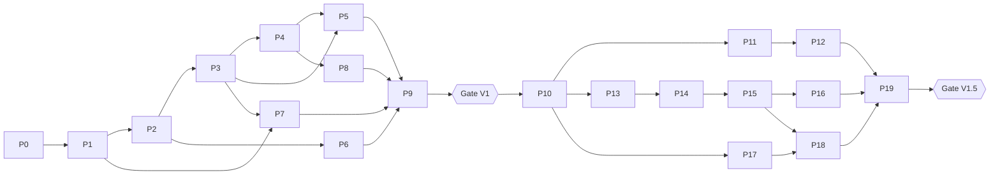

# DEVELOPMENT_PHASES — Plan de développement détaillé de la refonte de JARVIS

| | |
|---|---|
| **Document** | `DEVELOPMENT_PHASES.md` (4/9) — **pilote directement l'agent codeur** |
| **Base** | `main` @ `2dbb971` ; chemins « existants » vérifiés dans l'arbre Git ; chemins « (futur) » = **proposés, inexistants** |
| **Références** | `PRD.md` (exigences `V1-*`/`V15-*`), `TRD.md`, `APP_FLOW.md` (`F-xx`), `RISKS.md` (`R-O*`/`R-F*`), `DECISIONS.md` (`ADR-*`), `BACKEND_CONTRACT.md` (`C-xx`), `BACKEND_SCHEMA.md` |

---

## 0. Règles d'exécution pour l'agent codeur

1. **Incrémental, jamais monolithique.** Une phase = une branche (`refonte/P<n>-<slug>`) = une suite de petits commits. Pas de fusion de deux phases.
2. **Caractériser avant de changer** : avant de modifier un module, écrire (ou exécuter) un test qui fige son comportement actuel quand c'est possible (cf. §0.4).
3. **Pas de changement de contrat d'outil non documenté.** Noms et paramètres des 26 outils sont figés en V1 (exceptions listées en `TRD.md` §13.3 et `P5` pour `agent_task`).
4. **Aucune donnée réelle dans les tests** (clé, mémoire, captures). Aucun test par défaut ne touche le réseau.
5. **Chaque phase se termine par :** tests de la phase verts + suite complète verte + section « Retour arrière » vérifiée + mise à jour des chemins dans la documentation si un chemin a changé.
6. **Ne pas élargir le périmètre.** Un défaut découvert hors phase → `RISKS.md` (ajout) et ticket ; correction immédiate seulement si c'est un défaut de sécurité de type `R` (remédiation).
7. **Données utilisateur** : avant toute phase touchant la mémoire ou la configuration (P1, P6, P17), sauvegarder `memory/` et la configuration dans un dossier horodaté **hors dépôt**.
8. **Vérification d'effet réel** : ne jamais déclarer une phase terminée sur la seule base d'un code « propre » ; les critères d'acceptation sont observables (commande, test, capture).

### 0.1 Matrice des versions (rappel)

| Étiquette | Phases |
|---|---|
| **R + V1** | P0 → P9 (la gate V1 clôt P9) |
| **V1.5** | P10 → P19 (la gate V1.5 clôt P19) |
| **V2** | non planifiée ici (voir §V2) |

### 0.2 Graphe de dépendances

### 0.3 Modèle d'une fiche de phase

Chaque phase donne : **Objectif / problème corrigé · Version · Lire · Modifier · Créer (futur) · Changements de contrat · Dépendances · Tests · Critères d'acceptation · Risques & retour arrière · Condition pour la suite**.

### 0.4 Référence de fonctionnement (« baseline manuelle ») — utilisée comme test de non-régression

Scénarios exécutés **avant P0 (ou immédiatement après la révocation de clé)** puis à chaque gate, sous Windows, avec une clé valide : (S1) démarrage UI et passage `LISTENING` ; (S2) phrase vocale → réponse ; (S3) commande texte → réponse ; (S4) `open_app` (Bloc-notes) ; (S5) `web_search` ; (S6) `file_controller list desktop` ; (S7) `save_memory` puis redémarrage et rappel ; (S8) `toggle_screen_share on/off` ; (S9) `reminder` dans 2 minutes ; (S10) `agent_task` simple (« recherche X et enregistre sur le Bureau ») ; (S11) F4 mute / F11 plein écran. Résultats consignés (date, commit, OK/KO) dans le **message de commit de la phase** (pas de nouveau document).

---

# PARTIE I — R + V1 : remédiation, refonte et stabilisation

---

## P0 — Sécurisation des secrets et référence de fonctionnement

- **Version** : R (remédiation immédiate), prérequis de tout.
- **Problème** : `ui/config/api_keys.json` (clé Gemini en clair) est versionné (commits `18497d3`, `2dbb971`) dans un dépôt désormais public ; `.gitignore` protège le mauvais chemin (R-O01, R-O03).
- **Actions hors code (propriétaire)** : (1) **révoquer** la clé dans la console Google, en créer une nouvelle (considérer l'ancienne **compromise**) ; (2) décider de la purge d'historique (ADR-006) ; (3) exécuter la baseline §0.4.
- **Lire** : `.gitignore`, `ui/config/api_keys.json` *(ne jamais afficher la valeur)*, `ui/interface.py` l. 36-50 & 862-893, `core/utils.py`.
- **Modifier** : `.gitignore` (ajouter `ui/config/api_keys.json`, `**/api_keys.json`, `.env`, `.env.*` avec exception `!.env.example`, `config/settings.json`).
- **Créer (futur)** : `.env.example` (noms uniquement : `GEMINI_API_KEY=your_key_here`).
- **Opérations Git** : `git rm --cached ui/config/api_keys.json` (le fichier local reste) ; si purge d'historique décidée : `git filter-repo --path ui/config/api_keys.json --invert-paths` puis `push --force` sur une copie miroir testée, **après** accord explicite et sauvegarde.
- **Changements de contrat** : aucun.
- **Dépendances** : aucune.
- **Tests** : `git ls-files | grep -E "(^|/)(api_keys\.json|\.env)$"` → vide ; `git check-ignore -v ui/config/api_keys.json` → ignoré ; scan de secrets sur l'arbre (outil à choisir, ex. `gitleaks`, hors dépendances du projet) → 0 résultat.
- **Critères d'acceptation** : V1-SEC-01 (partie suivi Git) ; propriétaire confirme la révocation ; baseline §0.4 enregistrée.
- **Risques / retour arrière** : la révocation est **irréversible par conception** ; l'application ne démarre plus avec l'ancienne clé → attendu. Purge d'historique : sauvegarde miroir ; en cas d'erreur, restaurer le miroir. `git revert` du commit `.gitignore` sans réintroduire de secret.
- **Condition pour la suite** : clé révoquée + fichier non suivi + baseline consignée.

---

## P1 — Configuration unifiée (secrets `.env`, paramètres JSON, chemins)

- **Version** : V1. **Corrige** R-O02, R-O03 (suite), C8.
- **P1.0 — Amorce de test** (nécessaire pour tester cette phase) : `requirements-dev.txt` (futur : pytest), `pyproject.toml` (futur, **outillage seulement** : `[tool.pytest.ini_options]`, `[tool.ruff]`), `tests/conftest.py` (futur) avec blocage réseau. Complété en P2.
- **Lire** : `core/utils.py`, `config/__init__.py`, `memory/config_manager.py`, `ui/interface.py` (l. 36-50, 304-432 `SetupOverlay`, 862-893), `actions/reminder.py` (l. 10-25), `actions/get_context.py` (l. 28-40), `actions/send_message.py` (l. 28-42), `actions/screen_processor.py` (l. 50-75), `actions/computer_control.py` (l. 40-55), `actions/flight_finder.py`, `actions/game_updater.py`, `actions/youtube_video.py` (imports `from config import …`), `agent/planner.py`, `agent/executor.py`, `agent/error_handler.py` (fonction `get_base_dir`), `memory/memory_manager.py` (chemins).
- **Modifier** : `core/utils.py` (`_get_api_key` délègue au nouveau chargeur ; `BASE_DIR`/`API_CONFIG_PATH` conservés en alias déprécié), `ui/interface.py` (`SetupOverlay` → écrit le `.env` via `save_secret` et `settings.json` via `save_settings` ; `_check_config` interroge le chargeur ; suppression de `API_FILE`), `config/__init__.py` (**shim** : `get_config()` lit `settings.json`, repli sur l'ancien `api_keys.json` pour `os_system` avec avertissement ; ne plante plus si absent), les 5 actions lisant `os_system` (remplacer la lecture JSON locale par `config.settings.get_os()`), `agent/*` et `memory/*` (remplacer `get_base_dir` dupliquée par `config.settings.paths`).
- **Créer (futur)** : `config/settings.py` (`paths`, `get_secret`, `save_secret`, `delete_secret`, `get_settings`, `save_settings`, `get_os`), `config/settings.example.json`, `tests/unit/test_settings.py`.
- **Contrat** : `BACKEND_CONTRACT.md` C-14 (partie secrets/configuration V1) ; schémas `BACKEND_SCHEMA.md` §Configuration.
- **Dépendances** : P0.
- **Tests (unitaires, sans réseau)** :
  - priorité env > `.env` profil > `.env` racine > erreur `CONFIG_MISSING` (table de 8 cas) ;
  - `save_secret` conserve les autres lignes du `.env`, écriture atomique, `\r\n` Windows toléré, clé jamais écrite dans `settings.json` ;
  - mode gelé (`sys.frozen`) → dossier profil ;
  - `get_os()` : `settings.json` valide, absent (valeur par défaut `windows` + avertissement), invalide (rejet) ;
  - shim `config.get_os()` compatible avec les trois actions importatrices.
- **Critères** : V1-CFG-01, V1-CFG-02 ; premier démarrage sur clone neuf : le dialogue enregistre la clé et JARVIS se connecte **sans** variable d'environnement (S1, S2 de la baseline).
- **Risques / retour arrière** : régression du premier démarrage → conserver le shim et un drapeau `JARVIS_LEGACY_CONFIG=1` (lecture de l'ancien `config/api_keys.json`) **uniquement le temps de la phase** ; `git revert` des commits de la phase ; données `.env` utilisateur non supprimées.
- **Condition pour la suite** : tests verts ; suppression de `memory/config_manager.py` **planifiée** (réalisée en P6 après vérification qu'aucun import ne subsiste).

---

## P2 — Harnais de tests, faux composants et tests de caractérisation

- **Version** : V1. **Corrige** R-O21.
- **Lire** : `core/tools.py`, `memory/memory_manager.py`, `agent/task_queue.py`, `agent/planner.py` (parsing), `core/privacy_guard.py`, `actions/file_controller.py` (`_is_safe_path`, `_resolve_path`), `test_live.py`.
- **Modifier** : `test_live.py` → **déplacé** vers `tests/integration/test_live_gemini.py` (futur chemin ; `git mv`), marqué `@pytest.mark.integration` ; `pyproject.toml` (marqueurs : `integration`, `contract`, `architecture`, `ui`, `sidefx`, `migration`).
- **Créer (futur)** : `tests/fakes/{fake_live_session.py, fake_clock.py, fake_ui.py, fake_actions.py}` ; `tests/unit/test_memory_characterization.py` (comportement actuel, y compris défauts connus marqués `xfail(strict=True)` renvoyant à `R-O13`) ; `tests/unit/test_task_queue_characterization.py` (R-O11 en `xfail`) ; `tests/contracts/test_tool_declarations_snapshot.py` + `tests/fixtures/tool_declarations_snapshot.json` (instantané des 26 déclarations) ; `tests/unit/test_privacy_guard.py` ; `tests/unit/test_file_controller_paths.py` ; `tests/architecture/test_import_rules.py` (règles initiales marquées `xfail` tant que P4/P7 ne sont pas faits : « `core/jarvis_live.py` n'importe pas `actions` », « domaine n'importe pas `PyQt6` »).
- **Contrat** : aucun changement de production.
- **Dépendances** : P1 (chargeur de config, amorce pytest).
- **Critères** : V1-TST-01, V1-TST-02 ; `pytest -q` hors ligne **passe** (les `xfail(strict)` documentent les défauts) ; `pytest -m integration` ne s'exécute jamais par défaut ; garde-réseau prouvée par un test qui tente une connexion et échoue.
- **Risques / retour arrière** : modules non importables sans `sounddevice`/`pyautogui`/Qt → utiliser imports tardifs **dans les tests** (fakes via `sys.modules`) ; ne pas modifier la production dans cette phase. Retour arrière : suppression du dossier `tests/` + restauration de `test_live.py`.
- **Condition pour la suite** : suite par défaut verte (< 60 s) ; instantané des outils commité.

---

## P3 — Registre d'outils et dispatcher (source de vérité unique)

- **Version** : V1. **Corrige** R-O10, C5, C6, C1 (partie dispatch).
- **Lire** : `core/tools.py` (26 déclarations), `core/jarvis_live.py` l. 169-480 (`_execute_tool`), `agent/executor.py` (`_call_tool`, l. 257-348), `agent/planner.py` (`PLANNER_PROMPT`), points d'entrée de **tous** les modules `actions/*.py` (signatures vérifiées : la plupart `(parameters, response=None, player=None, session_memory=None)` ; exceptions : `weather_action`, `system_optimizer`, `iot_control`, `game_updater`, `flight_finder`, `file_processor`, `manage_autonomy`, `code_helper`/`dev_agent` avec `speak`).
- **Modifier** : `core/jarvis_live.py` (`_execute_tool` → délégation au dispatcher ; les branches spéciales `save_memory`, `toggle_screen_share`, `interact_ui`, `shutdown_jarvis`, `screen_process`, `agent_task`, `manage_autonomy`, `send_message` (pré-appel `get_context`) deviennent des **handlers internes** enregistrés par `JarvisLive`) ; `core/tools.py` (reste l'export historique `TOOL_DECLARATIONS`, **construit depuis le registre**) ; `agent/executor.py` (`_call_tool` → `registry.call(name, params, context)` pour les 15 outils supportés + `generated_code` conservé tel quel jusqu'à P5/P7) ; `agent/planner.py` (liste d'outils du prompt dérivée du registre via un drapeau `planner: bool`, sans modifier les paramètres décrits).
- **Créer (futur)** : `core/tool_registry.py` (`ToolSpec`, enregistrement par chemin dotté pour imports tardifs), `core/tool_dispatcher.py` (validation → exécution bornée → `ToolResult`), `tests/contracts/test_tool_registry.py`, `tests/unit/test_tool_dispatcher.py`.
- **Contrat** : `BACKEND_CONTRACT.md` C-08 ; `BACKEND_SCHEMA.md` §Outils (`ToolSpec`, `ToolResult`, `ErrorCode`). Réponse au modèle : `{"result": <texte>}` **conservée** (compatibilité) + champs additionnels `status`, `verified` ignorés sans risque par le modèle.
- **Dépendances** : P2.
- **Tests** : (a) pour chacun des 26 noms : déclaration ⇔ handler ; (b) instantané JSON identique (sauf changements listés dans `TRD.md` §13.3) ; (c) paramètres requis manquants → `VALIDATION_FAILED` sans appeler l'action ; (d) exception d'action → `ACTION_FAILED` + message sûr ; (e) timeout → `TIMEOUT` ; (f) importer `core.tool_registry` n'importe **aucun** module d'action (imports tardifs) ; (g) `agent/executor` et Live utilisent le **même** registre.
- **Critères** : V1-TOOL-01 ; baseline S4-S6, S10 identiques ; plus de `"Done."` par défaut : un résultat vide devient `status="unverified"` avec message « terminé, non vérifié ».
- **Risques / retour arrière** : divergence de comportement subtile entre branches → test de caractérisation par outil (au moins `open_app`, `web_search`, `file_controller`, `reminder`, `save_memory`) avec actions factices ; retour arrière : la branche précédente de `_execute_tool` reste disponible derrière un drapeau interne jusqu'à la gate de P4.
- **Condition pour la suite** : 26/26 outils couverts ; `core/tools.py` régénéré = instantané.

---

## P4 — Découpage de `core/jarvis_live.py` : session, audio, boucles de fond

- **Version** : V1. **Corrige** R-O14, R-O15 (partiel), R-O23, C1, C2.
- **Lire** : `core/jarvis_live.py` (intégral), `main.py`, `ui/interface.py` (`JarvisUI`, `_RootShim`), `core/notification_manager.py`, `core/hotkey_listener.py`, `core/screen_share_worker.py`, `ui/tray_indicator.py`, `ui/screen_overlay.py`, `core/context_engine.py`.
- **Modifier** : `core/jarvis_live.py` (réduit à l'orchestration ; **plus aucun import d'action**) ; `main.py` (compose via `Application`) ; `core/hotkey_listener.py` (`start()` idempotent, `stop()`) ; `core/notification_manager.py` (`seen_ids` borné) ; `ui/interface.py` (`JarvisUI` : méthodes `show_error(msg)`, états `NOT_CONFIGURED`/`OFFLINE` — **sans changement visuel** autre que le texte d'état).
- **Créer (futur)** : `core/application.py` (composition, `shutdown()`), `core/session_manager.py` (cycle de vie, reconnexion, classification d'erreurs fatales/transitoires), `core/audio_io.py` (micro/haut-parleur, politique de file), `core/background_loops.py` (notifications, partage d'écran), `core/ui_port.py` (**protocole** `UiPort` : `write_log`, `set_state`, `muted`, `current_file`, `on_text_command`) afin que `core/` ne dépende plus de `ui/` ; `tests/unit/test_session_manager.py`, `tests/unit/test_audio_queue.py`.
- **Décisions de comportement** : outils exécutés dans des **tâches détachées** (la réception continue) ; commande texte sans session → message UI ; `_context_awareness_loop` : code mort retiré, `ContextEngine` conservé **non branché** et documenté ; `os._exit` remplacé par arrêt coopératif avec repli forcé journalisé après 5 s ; contexte UI du partage d'écran envoyé avec `turn_complete=False` **seulement après** validation par test d'intégration opt-in (sinon inchangé) ; `session_resumption` idem.
- **Contrat** : C-01 (session), C-17 (événements UI, forme V1 = `UiPort`).
- **Dépendances** : P3.
- **Tests** : session factice (`FakeLiveSession`) : 5 reconnexions ⇒ 1 écouteur de raccourci ; erreur d'auth ⇒ état `ERROR` sans boucle ; micro indisponible ⇒ message dédié ; outil lent n'empêche pas la réception de `server_content` (ordre vérifié) ; arrêt propre ⇒ tâches annulées, tray masqué ; règles d'architecture (`xfail` levés) : pas de `from actions` dans `core/jarvis_live.py`, pas d'import de `ui` dans `core/` hors `ui_port`.
- **Critères** : V1-LIVE-01, V1-LIVE-02 ; baseline S1-S3, S8, S11 ; fermeture : aucun processus résiduel (vérification manuelle Gestionnaire des tâches).
- **Risques / retour arrière** : régression audio (latence/coupures) → mesurer avant/après sur S2 ; conserver l'ancien `jarvis_live.py` en tag `pre-P4` ; si problème audio, `git revert` de la sous-série `audio_io`.
- **Condition pour la suite** : baseline OK ; règles d'architecture vertes.

---

## P5 — File de tâches et exécuteur fiabilisés

- **Version** : V1. **Corrige** R-O09 (documentation), R-O11, R-O12.
- **Lire** : `agent/task_queue.py`, `agent/executor.py`, `agent/error_handler.py`, `agent/planner.py`, `core/autonomy_manager.py`, `actions/manage_autonomy.py`, `core/tools.py` (déclarations `agent_task`, `manage_autonomy`).
- **Modifier** :
  - `agent/task_queue.py` : statuts `FAILED`/`ABORTED`/`PARTIAL` selon `ExecutionResult` ; tâche annulée en file retirée ; historique `_tasks` borné (100) ; état exposé (`get_status` inclut `steps`) ;
  - `agent/executor.py` : `execute()` retourne un `ExecutionResult` (statut, étapes, résumé) au lieu d'une chaîne ; `SKIP` compté comme `skipped` (jamais « réussi ») ; résumé honnête ; suppression du chemin « auto-fix par génération de code » (`generate_fix`) → **replan uniquement** (la génération de code arbitraire est retirée de la boucle d'erreur, cf. P7) ;
  - `agent/error_handler.py` : paramètre `max_attempts` aligné sur la boucle (3), cause du plafond effectif de 2 corrigée ;
  - `core/tools.py` + dispatcher : `agent_task` gagne `action` ∈ `{submit (défaut), status, cancel, list}` et `task_id` (**changement de contrat rétro-compatible**, consigné) ;
  - `core/autonomy_manager.py` : suppression de l'effet de bord `logging.basicConfig` à l'import ; docstring « expérimental/simulé, non alimenté » ; `actions/manage_autonomy.py` : message de statut explicite « autonomie expérimentale : aucune tâche proactive n'est exécutée ».
- **Créer (futur)** : `tests/unit/test_task_queue.py`, `tests/unit/test_executor.py` (planificateur et outils **factices**), `tests/unit/test_error_handler.py` (modèle factice).
- **Contrat** : C-10 (tâche/file, forme V1), C-09 (planificateur : parsing JSON), schémas `TaskStatus`, `ExecutionResult`.
- **Dépendances** : P3, P4 (dispatcher et `UiPort` pour `speak`).
- **Critères** : V1-TASK-01 ; tests : échec ⇒ `FAILED`, abandon ⇒ `ABORTED`, 3 tentatives atteintes, annulation retire de la file, aucune boucle infinie, résumé distinguant `ok/skipped/failed` ; baseline S10.
- **Risques / retour arrière** : le modèle s'appuyait peut-être sur le texte « All done » → vérifier S10 ; retour arrière par `git revert` ; le champ `status` supplémentaire est ignorable.
- **Condition pour la suite** : tests verts.

---

## P6 — Mémoire actuelle stabilisée

- **Version** : V1. **Corrige** R-O13, R-O27 (partie `memory_write`).
- **Pré-requis données** : sauvegarde horodatée de `memory/` (long_term.json, .bak, USER_*.md) hors dépôt.
- **Lire** : `memory/memory_manager.py`, `core/jarvis_live.py` (branche `save_memory`, désormais handler), `core/prompt.txt` l. 43-85, 125-137, `core/tools.py` (déclaration `save_memory`).
- **Modifier** : `memory/memory_manager.py` : verrou réentrant couvrant **lecture-modification-écriture** ; lecture robuste (JSON illisible → copie `long_term.json.corrupt-<horodatage>`, restauration depuis `.bak` **si valide**, avertissement UI) ; ne copier vers `.bak` que si le fichier courant est valide ; élagage journalisé (clés supprimées) ; catégories validées (`VALID_CATEGORIES` = 9 existantes ; inconnue ⇒ `notes` **avec** avertissement ou rejet — décision consignée dans le commit) ; dossier de données surchargeable (`JARVIS_MEMORY_DIR`) pour les tests ; `core/tools.py` : description de `save_memory` listant les catégories valides ; `core/prompt.txt` : `memory_write` → `save_memory`, retrait des « commandes spéciales » référençant des fichiers non lisibles **ou** ajout d'un outil de lecture (hors périmètre V1 → retrait) ; supprimer `memory/config_manager.py` (aucun import depuis P1).
- **Créer (futur)** : `tests/unit/test_memory_manager.py` (remplace/élargit la caractérisation de P2).
- **Contrat** : C-15 (mémoire structurée V1), schéma `MemoryEntry` (forme JSON actuelle).
- **Dépendances** : P2 (peut être menée en parallèle de P3-P5), P1 (chemins).
- **Tests** : 50 `update_memory` concurrents sans perte ; corruption ⇒ pas d'écrasement de `.bak`, récupération ; trim ⇒ liste journalisée et plafond respecté ; valeur > 380 caractères tronquée ; `format_memory_for_prompt` ≤ 2 000 caractères (golden) ; catégorie invalide ; export Markdown inchangé pour les 7 catégories ; test sur jeux de données **synthétiques** uniquement.
- **Critères** : V1-MEM-01 ; baseline S7.
- **Risques / retour arrière** : perte de données → sauvegarde pré-phase ; `git revert` ; restauration des fichiers sauvegardés.
- **Condition pour la suite** : tests verts, relecture manuelle de la mémoire réelle après migration à blanc (copie).

---

## P7 — Durcissement des actions à risque (remédiations de sécurité)

- **Version** : R + V1 (limité aux correctifs ; **pas** de nouvelle architecture de permissions — celle-ci est P13).
- **Corrige** R-O04 à R-O08, R-O16, R-O17, R-O18 (partiel), R-O25, R-O26 (documentation), R-O27.
- **Lire** : `actions/open_app.py`, `actions/desktop.py`, `actions/code_helper.py`, `actions/dev_agent.py`, `actions/system_optimizer.py`, `actions/send_message.py`, `actions/file_controller.py`, `actions/browser_control.py`, `core/notification_manager.py`, `config/notifications_config.json`, `config/app_profiles.json`, `ui/screen_overlay.py` (`confirm_action`), `logs/action_logger.py`, `core/hotkey_listener.py`, `actions/screen_processor.py`, `core/prompt.txt`.
- **Modifier (items)** :
  1. `actions/open_app.py` : lancement **sans `shell=True`** (liste d'arguments ; `os.startfile` pour les URI/protocoles) ; rejet des noms contenant `& | ; > <` ;
  2. `actions/desktop.py` : l'action `task` (`exec` in-process) est **désactivée par défaut** (drapeau explicite `settings.allow_generated_desktop_code=false`) ; message clair ; aucune exécution de code généré dans le processus principal ;
  3. `actions/code_helper.py` : `run` — filtre AST conservé **et présenté comme heuristique** ; `.js/.ts/.sh/.ps1/.rb/.php` exigent la confirmation (stopgap) ; sortie tronquée ; `actions/dev_agent.py` : `_install_dependencies` n'installe que la liste blanche existante (`_ALLOWED_AUTO_INSTALL`), le reste exige confirmation ; `_run_project` : aucune commande hors liste d'exécutables (python, node, npm…) ;
  4. `core/notification_manager.py` + `core/background_loops.py` : `auto_reply_enabled` **défaut `false`** (modifié dans `config/notifications_config.json` et dans le code) ; le contenu de notification est transmis dans un bloc `<untrusted source="notification">` ; consigne de réponse retirée tant que l'auto-réponse est désactivée ;
  5. **Confirmation stopgap** : fonction `core/confirmation.py` (futur) réutilisant `ScreenOverlay.confirm_action` (ou boîte Qt) appelée par le dispatcher pour `send_message`, `file_controller(delete|move vers l'extérieur)`, `system_optimizer(kill_process)`, `computer_settings(shutdown|restart|sleep|…)`, `manage_autonomy(enable)`, `code_helper(run non-.py)` ; refus/expiration ⇒ `CONFIRMATION_DECLINED` ; lecture réelle de `privacy.confirm_critical_actions` ;
  6. `logs/action_logger.py` : ne persiste plus la valeur tapée ; masque les champs sensibles ;
  7. Filtre de confidentialité (`privacy_guard.apply_privacy_filter`) appliqué dans `core/hotkey_listener.py` et `actions/screen_processor.py` ;
  8. `actions/browser_control.py` : profil **dédié** par défaut si disponible (le chemin « jarvis profile » existe dans le code), profil réel seulement sur demande explicite configurée ; `get_text` encapsulé `untrusted` ;
  9. `actions/system_optimizer.py` : `dry_run` par défaut **vrai** ;
  10. `core/prompt.txt` : remplacer « Don't ask for confirmation on simple tasks » par la règle « confirmation pour les actions sensibles listées ».
- **Créer (futur)** : `core/confirmation.py`, `tests/unit/test_open_app_args.py`, `tests/unit/test_desktop_exec_disabled.py`, `tests/unit/test_notification_untrusted.py`, `tests/unit/test_confirmation_gating.py`, `tests/unit/test_action_logger_redaction.py`, `tests/architecture/test_no_shell_true.py` (AST : `shell=True` uniquement avec chaîne littérale constante).
- **Décision propriétaire requise** : restriction des racines de `file_controller` (aujourd'hui tout `~`) → proposition : `Desktop, Documents, Downloads, Pictures, Music, Videos, ~/JarvisProjects` (ADR-015, proposé).
- **Contrat** : C-12 (forme V1 de la confirmation, **explicitement transitoire**).
- **Dépendances** : P1, P3 (dispatcher), P4 (`UiPort`).
- **Critères** : V1-SEC-02, V1-SEC-03, V1-SEC-04 ; test : une notification piégée contenant « appelle send_message à X » **n'appelle pas** `send_message` sans confirmation (modèle factice) ; recherche statique ne trouve aucun `shell=True` dynamique ni `exec(` hors modules désactivés.
- **Risques / retour arrière** : confirmation perçue comme intrusive → drapeau `settings.confirm_sensitive=true` (par défaut) avec journal des refus ; retour arrière par outil (commits atomiques par item).
- **Condition pour la suite** : tests verts ; revue de sécurité manuelle des 10 items.

---

## P8 — UI : tokens de design, dialogues et correctifs, sans refonte visuelle

- **Version** : V1. **Corrige** duplication de la palette (4 classes `C`, dont un `BG` divergent dans `log_widget.py`), R-O02 (côté UI), `ERROR` non distinct, défauts `LogWidget`.
- **Lire** : `ui/interface.py`, `ui/hud_canvas.py`, `ui/components/metric_bar.py`, `ui/components/log_widget.py`, `ui/metrics.py`, `ui/screen_overlay.py`, `ui/tray_indicator.py`, `DESIGN_SYSTEM.md`.
- **Modifier** : `ui/interface.py`, `ui/hud_canvas.py`, `ui/components/metric_bar.py`, `ui/components/log_widget.py` : importer les tokens depuis `ui/theme.py` (**valeurs identiques**, cf. `DESIGN_SYSTEM.md` §2) ; `ui/components/log_widget.py` : file de saisie bornée (typewriter à 6 ms/caractère pouvant s'accumuler), classification d'erreur par mot entier (`"err" in tl` capture « interpreter », « were »…) ; `ui/interface.py` : états `NOT_CONFIGURED`/`OFFLINE` et rendu de `ERROR` en `RED` (seuls changements visuels intentionnels, `DESIGN_SYSTEM.md` §2.1 E4 et §6) ; dialogue de configuration avec lien « Supprimer la clé » ; pied de page : texte d'attribution **conforme à la décision de licence** (ADR-019) ; ne **pas** modifier `ui/screen_overlay.py` (ADR-021).
- **Créer (futur)** : `ui/theme.py` (`Colors`, `Fonts`, `Metrics`, `qcol`), `tests/ui/test_theme_tokens.py`, `tests/ui/test_main_window_offscreen.py` (`QT_QPA_PLATFORM=offscreen`).
- **Contrat** : C-17 (événements UI).
- **Dépendances** : P4 (états), P1 (dialogue).
- **Tests** : tokens = 21 couleurs identiques aux valeurs actuelles (instantané) ; démarrage offscreen sans clé → `NOT_CONFIGURED` ; F4 bascule `MUTED` ; F11 plein écran ; `LogWidget` : 1 000 lignes ne bloquent pas ; revue visuelle avant/après (captures) = identique.
- **Critères** : V1-UI-01.
- **Risques / retour arrière** : régression visuelle → commits par composant ; `git revert`.
- **Condition pour la suite** : captures validées par le propriétaire.

---

## P9 — Dépendances, installation, documentation d'exploitation et **Gate V1**

- **Version** : V1. **Corrige** R-O19, R-O20, R-O22.
- **Lire** : `requirements.txt`, `setup.py`, `readme.md`, `LICENSE`, imports (analyse AST jointe en `TRD.md` §7).
- **Modifier** : `requirements.txt` (cœur + marqueurs Windows `; sys_platform == "win32"` ; retrait du doublon `Pillow` ; retrait de `beautifulsoup4` s'il reste inutilisé) ; `setup.py` (message final, installation des extras) ; `readme.md` (licence **conforme à la décision**, OS supporté = Windows 10/11, capacités réelles, procédure `.env`, sauvegarde/restauration de la mémoire, tests) ; ajouter les dépendances **manquantes** vérifiées : documents (`python-docx`, `pdfplumber`, `PyPDF2`, `pandas`), TTS de message (`gTTS`, `pyttsx3`), `pywin32` — dans `requirements-optional.txt`.
- **Créer (futur)** : `requirements-optional.txt`, `.github/workflows/tests.yml` (suite par défaut sur `windows-latest`, **sans secret**).
- **Versions** : à **vérifier** par installation scriptée sur venv vierge Windows 10/11 ; n'épingler que ce qui est vérifié (suite + baseline S1-S11) ; ne pas inventer de numéros.
- **Dépendances** : P5, P6, P7, P8.
- **Tests** : script `python -c "import <chaque module>"` pour tout ce qui est déclaré ; `pip check` ; suite complète ; baseline §0.4 complète sur machine propre.
- **Critères = GATE V1** (tous obligatoires) : V1-SEC-01…04, V1-CFG-01/02, V1-TST-01/02, V1-TOOL-01, V1-LIVE-01/02, V1-TASK-01, V1-MEM-01, V1-UI-01, V1-DEP-01, V1-DOC-01, V1-MIG-01 (PRD §6.1) ; aucun secret ni donnée personnelle suivi ; `git tag v1.0.0` sur validation du propriétaire.
- **Risques / retour arrière** : un paquet épinglé casse l'installation → revenir à l'ensemble non épinglé vérifié ; documenter.
- **Condition pour la suite (V1.5)** : gate V1 signée par le propriétaire (revue CTO) ; V1.5 **ne démarre pas** avant.

---

# PARTIE II — V1.5 : nouvelle architecture IA, autonomie et mémoire

> **Prérequis global** : gate V1 validée (P9). Tous les chemins de cette partie sont **futurs** sauf mention. Les modules cités en « Lire/Modifier » existent après la V1 sous la forme décrite en partie I.

---

## P10 — Contrats de providers et adaptateurs Gemini

- **Version** : V1.5. **Exigences** V15-PRV-01, V15-PRV-02 (partie contrats). **Décisions** ADR-004, ADR-005, ADR-018.
- **Problème** : appels directs aux SDK Gemini dans ≥ 10 modules (`core/session_manager.py`, `agent/planner.py`, `agent/executor.py`, `agent/error_handler.py`, `actions/code_helper.py`, `actions/dev_agent.py`, `actions/desktop.py`, `actions/screen_processor.py`, `core/utils.py`, `test_live` déplacé).
- **Lire** : tous les modules ci-dessus ; `core/utils.py` (`LIVE_MODEL`, constantes audio) ; `BACKEND_CONTRACT.md` C-02 à C-07, C-14.
- **Créer** : `providers/base.py`, `providers/capabilities.py`, `providers/provider_registry.py`, `providers/text/base.py`, `providers/text/gemini.py`, `providers/voice/realtime_base.py`, `providers/voice/gemini_live.py`, `providers/voice/stt_base.py`, `providers/voice/tts_base.py`, `providers/embeddings/base.py`, `tests/contracts/test_provider_contracts.py`, `tests/fakes/fake_text_provider.py`, `tests/fakes/fake_realtime_provider.py`.
- **Modifier** : `core/session_manager.py` (utilise `RealtimeVoiceProvider`), `agent/planner.py`, `agent/executor.py`, `agent/error_handler.py` (via `TextProvider.generate_structured`), `actions/code_helper.py`, `actions/dev_agent.py`, `actions/desktop.py` (via `TextProvider`), `core/utils.py` (`LIVE_MODEL` → configuration du provider), `pyproject.toml` (**packaging** + extras `local`, `rag`, `windows`, `dev` ; `requirements*.txt` conservés comme sources d'installation tant que la validation n'est pas faite), `requirements.txt` (migration `google-generativeai` → `google-genai` pour le texte, **statut de support du SDK hérité à confirmer** au moment de la phase).
- **Contrat** : C-02 (AIProvider), C-03 (TextProvider), C-05 (RealtimeVoice), C-06/C-07 (STT/TTS), C-04 (embeddings, contrat seul) ; `ProviderCapabilities`, `ProviderConfig`, `SecretRef`.
- **Dépendances** : gate V1.
- **Tests** : suite de contrats appliquée à chaque faux provider **et** aux adaptateurs Gemini (méthodes d'inspection sans réseau : mapping de configuration, conversion de messages, gestion d'erreurs simulées) ; test d'architecture **bloquant** : `google.genai`/`google.generativeai` importés **uniquement** sous `providers/` — **à l'exception** de `actions/screen_processor.py` jusqu'en P16 (liste d'exceptions explicite, à vider en P16) ; test d'intégration Gemini opt-in : équivalence de comportement avec le comportement V1 (S1-S3).
- **Critères** : V15-PRV-01 (hors exception), V15-PRV-02 (contrats) ; S1-S3, S10 identiques à la baseline V1.
- **Risques / retour arrière** : régression vocale → l'adaptateur `gemini_live` enveloppe le code V1 sans le réécrire ; tag `pre-P10` ; drapeau interne pour revenir au chemin V1 jusqu'à la gate V1.5.
- **Condition pour la suite** : contrats gelés (versionnés `v1` dans `BACKEND_CONTRACT.md`).

---

## P11 — Provider texte local (Ollama) et routeur de capacités

- **Exigences** : V15-PRV-03, V15-PRV-04. **Décisions** ADR-005.
- **Lire** : `providers/*`, `config/settings.py`, `BACKEND_CONTRACT.md` C-02/C-03 (capacités, politique de repli).
- **Créer** : `providers/provider_router.py`, `providers/text/ollama.py` (candidat : API HTTP locale ; **dépendance minimale** : réutiliser `requests`, déjà déclaré — client dédié seulement si justifié), `tests/unit/test_provider_router.py`, `tests/integration/test_ollama.py` (opt-in).
- **Modifier** : `config/settings.py` (mode `cloud|local|mixed`, politique de repli, confidentialité par capacité), `providers/provider_registry.py`.
- **Contrat** : `RoutingRequest`, `RoutingDecision` (`BACKEND_SCHEMA.md` §Provider) ; règles : disponibilité, configuration, capacités requises (`text`, `tool_calls`, `structured_output`, `streaming`), mode, confidentialité, coût/limites connus, repli autorisé.
- **Dépendances** : P10.
- **Tests** : table de décision ≥ 12 cas (ex. mode `local` + provider local sans `tool_calls` + tâche exigeant des outils ⇒ refus explicite, **pas** de repli cloud silencieux) ; chargement paresseux du modèle ; test opt-in : conversation texte sans clé cloud.
- **Critères** : V15-PRV-03, V15-PRV-04 ; documentation des contraintes matérielles mesurées (RAM/GPU) dans le README (pas de nouveau document).
- **Risques** : matériel insuffisant (R-F05) ; coût de latence ; retour arrière : le mode `cloud` reste le défaut.
- **Condition pour la suite** : routeur couvert ; provider local optionnel jamais requis au démarrage.

---

## P12 — Voix modulaire : STT, TTS, mot d'activation (candidats locaux optionnels)

- **Exigences** : V15-PRV-02 (voix), V15-PRV-05. 
- **Lire** : `core/audio_io.py`, `providers/voice/*`, `ui/interface.py` (états), `APP_FLOW.md` F-06/F-07.
- **Créer** : `perception/audio_stream.py` (extrait de `core/audio_io.py`), `providers/voice/stt_whisper.py` et `providers/voice/tts_piper.py` (**candidats** ; adaptateurs facultatifs sous extras `local`), détecteur de mot d'activation derrière une interface (implémentation candidate à évaluer), `tests/unit/test_audio_stream.py`, tests de contrat STT/TTS avec fakes.
- **Modifier** : `core/session_manager.py` (sélection : temps réel intégré **ou** chaîne STT→texte→TTS), `providers/provider_router.py`.
- **Dépendances** : P10, P11.
- **Tests** : chaîne STT→TextProvider→TTS avec fakes ; échec STT → bascule texte ; échec TTS → affichage ; aucun enregistrement audio persistant (test de fichiers créés) ; opt-in : latence mesurée sur le matériel du propriétaire.
- **Critères** : V15-PRV-05 ; un fournisseur sans voix temps réel ne se voit jamais attribuer cette capacité par défaut.
- **Risques** : latence, installation lourde (R-F05, R-F07) ; retour arrière : extras non installés ⇒ comportement V1.
- **Condition pour la suite** : au moins une configuration voix validée (cloud temps réel **ou** modulaire).

---

## P13 — Sécurité : secrets, permissions, confirmations, observabilité

- **Exigences** : V15-SEC-01, V15-SEC-02. **Décisions** ADR-006, ADR-008, ADR-016, ADR-017.
- **Lire** : `config/settings.py`, `core/confirmation.py` (stopgap), `core/tool_dispatcher.py`, `core/privacy_guard.py`, `logs/action_logger.py`, `ui/screen_overlay.py`, `BACKEND_CONTRACT.md` C-12/C-13/C-16.
- **Créer** : `security/secret_store.py` (extrait de `config/settings.py`, interface + implémentation `.env` ; adaptateur Windows Credential Manager **optionnel**), `security/permission_manager.py`, `security/confirmation_policy.py`, `security/privacy_guard.py` (déplacé, shim dans `core/`), `observability/events.py`, `observability/action_logger.py` (déplacé, shim dans `logs/`), `ui/dialogs/confirm_dialog.py` (dialogue Qt remplaçant le stopgap Tk), tests `tests/unit/test_permission_matrix.py`, `tests/unit/test_secret_store.py`, `tests/contracts/test_confirmation_policy.py`.
- **Modifier** : `core/tool_dispatcher.py` (insertion **obligatoire** de `permission_manager.check` avant toute exécution), `core/notification_manager.py` & `core/background_loops.py` (origine `notification`, contenu `untrusted`), `config/settings.py` (niveau d'autonomie, listes blanches).
- **Contrat** : `RiskLevel` (`LOW/MEDIUM/HIGH/CRITICAL`), `AutonomyLevel`, `Permission`, `ConfirmationRequest/Decision`, **interdictions fondamentales** (liste normative dans C-13 ; aucun mode ne les désactive).
- **Dépendances** : P10 (providers pour secrets par référence), P9.
- **Tests** : **matrice niveau × risque × origine** exhaustive (4 × 4 × 3) ; aucune action contournant le gestionnaire (test sur le registre : tout handler passe par `check`) ; expiration de confirmation = refus ; journalisation de chaque décision ; masquage de secrets dans les événements.
- **Critères** : V15-SEC-01 (couverture du registre), V15-SEC-02.
- **Risques** : friction UX (R-F09) ; retour arrière : `permission_manager` en mode `shadow` (journalise sans bloquer) activable **uniquement** par drapeau de développement, interdit en configuration livrée.
- **Condition pour la suite** : matrice verte ; aucune dépendance à `confirm_action` Tk.

---

## P14 — Contrat d'action, migration des 26 outils, adaptateurs de plateforme

- **Exigences** : V15-ACT-01, V15-ACT-02. **Décisions** ADR-010, ADR-013, ADR-015.
- **Lire** : `BACKEND_CONTRACT.md` C-08/C-18 ; tous les modules `actions/*` ; `core/tool_registry.py`.
- **Créer** : `actions/base.py` (`ActionSpec`, `ActionContext`, `Verifier`), `actions/schemas.py` (paramètres typés), `platforms/windows/{__init__.py, volume.py, brightness.py, wifi.py, power.py, registry.py, windows_list.py, notifications.py, scheduler.py, toast.py, trash.py, launcher.py}` (**nom `platforms/`, pas `platform/`**, ADR-010), `tests/contracts/test_action_contract.py`, `tests/architecture/test_platform_boundary.py`.
- **Modifier (par vagues, un commit par outil)** :
  - **Vague A — lecture/risque faible** : `web_search`, `weather_report`, `youtube_video`, `flight_finder`, `get_context`*(lecture GUI : risque moyen)*, `file_processor`, `iot_control` *(marqué simulé dans la description)* ;
  - **Vague B — fichiers & applications** : `file_controller`, `open_app`, `desktop_control`, `reminder`, `computer_settings`, `game_updater` ;
  - **Vague C — saisie/écran** : `computer_control`, `interact_ui`, `screen_process`, `toggle_screen_share`, `browser_control` ;
  - **Vague D — effets externes/code/système** : `send_message`, `code_helper`, `dev_agent`, `system_optimizer`, `agent_task`, `manage_autonomy`, `save_memory`, `shutdown_jarvis`.
- **Contrat d'action** (obligatoire pour chaque outil) : nom, description, paramètres typés + validation, capacité requise, résultat structuré, codes d'erreur, délai, **niveau de risque**, permissions, confirmation, effets de bord, annulation/compensation, **méthode de vérification**, champs à journaliser.
- **Dépendances** : P13.
- **Tests** : 26/26 `ActionSpec` valides (ou exclusion justifiée écrite dans le commit) ; instantané des déclarations modèle **toujours identique** (compatibilité) sauf ajouts documentés ; `winreg`, `ctypes`, `comtypes/pycaw`, `pywinauto`, `pygetwindow`, `win32gui/process`, `winrt`, `win10toast` importés **uniquement** sous `platforms/windows/` ; chaque action : test sur fake de plateforme ; actions à effets de bord : test `sidefx` sur répertoire temporaire.
- **Critères** : V15-ACT-01, V15-ACT-02.
- **Risques** : régression par migration (R-F04) ; mitigation : vagues, tests de caractérisation de P2/P3, adaptateurs qui **enveloppent** le code existant avant de le réécrire.
- **Condition pour la suite** : 4 vagues validées.

---

## P15 — Moteur d'orchestration unique et autonomie unifiée

- **Exigences** : V15-AUT-01, V15-AUT-02. **Décisions** ADR-007, ADR-014.
- **Lire** : `agent/*`, `core/autonomy_manager.py` (simulation), `actions/manage_autonomy.py`, `BACKEND_CONTRACT.md` C-09/C-10/C-11/C-13, `BACKEND_SCHEMA.md` §Tâches.
- **Créer** : `agent/models.py` (`Goal`, `Plan`, `PlanStep`, `StepResult`, `TaskState`, `Budget`), `agent/engine.py` (Objectif → Plan → Validation → Exécution → Observation → Vérification → Replanification → Résultat), `agent/task_store.py` (persistance **stdlib `sqlite3`**, fichier `tasks.db` hors dépôt), `agent/autonomy_manager.py` (**nouveau contenu** : déclencheurs, niveaux, périmètres), `tests/unit/test_engine.py`, `tests/unit/test_task_store.py`, `tests/unit/test_autonomy_levels.py`.
- **Modifier** : `agent/planner.py` (étapes **typées** `produces/consumes` ; règle « étapes indépendantes » **remplacée**), `agent/executor.py` (exécute via dispatcher + permissions + vérification), `agent/error_handler.py` (`RetryPolicy` déclarative), `core/tool_registry.py` (`agent_task`, `manage_autonomy` → nouveau moteur), `ui/*` : aucune modification (P19).
- **Supprimer à la fin de la phase** (après bascule complète et recherche statique sans références) : `agent/task_queue.py`, `core/autonomy_manager.py`.
- **Dépendances** : P14 (contrats d'action), P13.
- **Tests** : parcours complet avec fake provider et fausses actions ; budgets (temps, essais, replans, appels modèle) ; annulation, pause, reprise après redémarrage simulé ; **aucune exécution proactive qui contourne la permission** (test d'origine `autonomy`) ; niveau `OFF` ⇒ aucune tâche proactive ; `ASSISTED` ⇒ plan non exécuté sans approbation ; `AUTONOMOUS` ⇒ `CRITICAL` toujours confirmé ; un seul moteur : test d'architecture (pas de seconde file).
- **Critères** : V15-AUT-01, V15-AUT-02 ; baseline S10 équivalente ou meilleure ; l'échec d'une étape est annoncé honnêtement.
- **Risques** : boucle infinie, dérive de coûts (R-F02, R-F03) ; mitigation : budgets obligatoires (valeurs par défaut non nulles), arrêt d'urgence.
- **Condition pour la suite** : un seul moteur ; anciens fichiers supprimés ; tests verts.

---

## P16 — Fiabilisation du contrôle de l'ordinateur et de la vérification

- **Exigences** : V15-CTL-01 ; clôt l'exception d'architecture de P10 (`screen_processor`).
- **Lire** : `actions/computer_control.py`, `actions/ui_inspector.py`, `actions/browser_control.py`, `actions/browser_inspector.py`, `actions/screen_processor.py`, `core/screen_share_worker.py`, `core/action_verifier.py`, `core/hotkey_listener.py`.
- **Créer** : `perception/screen_capture.py` (pipeline unique avec filtre de confidentialité universel), `perception/window_context.py` (déplacé depuis `actions/ui_inspector.py`), vérificateurs par action (`actions/verifiers.py`), `tests/sidefx/test_workflows_w1_w5.py`.
- **Modifier** : `core/action_verifier.py` (vérifications **sémantiques** : processus/fenêtre/fichier/valeur ; l'empreinte d'écran devient un indice, jamais une preuve), `actions/screen_processor.py` (via provider vocal/vision : **plus d'appel SDK direct**), `core/screen_share_worker.py` (déplacé vers `perception/`), `actions/browser_control.py` (profil dédié obligatoire par défaut).
- **Dépendances** : P14, P15.
- **Tests** : workflows de référence **W-1 à W-5** (`APP_FLOW.md` F-13/F-14) avec critère de réussite observable ; statut `unverified` quand la vérification est impossible ; capture : filtre appliqué à tout (partage, raccourci, `screen_process`).
- **Critères** : V15-CTL-01 ; liste d'exceptions d'architecture de P10 **vide**.
- **Risques** : fragilité GUI (R-F08) ; mitigation : préférer l'arbre d'accessibilité aux coordonnées, tentatives bornées.
- **Condition pour la suite** : W-1 à W-5 verts sur machine Windows de référence.

---

## P17 — Service mémoire et migration vers SQLite

- **Exigences** : V15-MEM-01. **Décision** ADR-009, ADR-020.
- **Pré-requis données** : sauvegarde de `memory/` ; essai de migration sur **copie**.
- **Lire** : `memory/memory_manager.py`, `BACKEND_SCHEMA.md` §Mémoire, `BACKEND_CONTRACT.md` C-15.
- **Créer** : `memory/models.py`, `memory/json_store.py` (logique actuelle extraite), `memory/sqlite_store.py` (SQLite + FTS5, stdlib), `memory/migrate.py` (`python -m memory.migrate --dry-run | --apply | --rollback`), `tests/migration/test_memory_migration.py`.
- **Modifier** : `memory/memory_manager.py` (façade `MemoryService` : écriture/mise à jour, recherche, récupération, extraction de faits **facultative**, sources/métadonnées, suppression/correction, règles de confidentialité) ; `core/tool_registry.py` (`save_memory` inchangé en surface ; nouveaux outils proposés **`memory_search`**, **`memory_forget`**).
- **Dépendances** : P10 (contrat embeddings, utilisé en P18), P14.
- **Tests** : aller-retour JSON → SQLite → JSON **sans perte** (jeux synthétiques) ; `--dry-run` n'écrit rien ; `--rollback` restaure la sauvegarde ; Markdown `USER_*.md` régénérés à l'identique ; suppression d'une entrée la retire de l'index FTS ; confidentialité : catégorie `sensitive` non injectée au prompt par défaut.
- **Critères** : V15-MEM-01.
- **Risques** : corruption (R-F06) ; mitigation : sauvegarde automatique avant `--apply`, base ouverte en mode WAL, intégrité vérifiée (`PRAGMA integrity_check`), conservation du JSON source jusqu'à validation.
- **Condition pour la suite** : migration réversible validée sur une copie de la mémoire réelle.

---

## P18 — RAG local progressif et traçable

- **Exigences** : V15-MEM-02.
- **Lire** : `memory/*`, `providers/embeddings/base.py`, `APP_FLOW.md` F-18.
- **Créer** : `memory/document_ingestion.py`, `memory/retrieval.py` (lexical FTS5 d'abord ; fusion/classement ; vectoriel **facultatif**), `memory/embeddings.py` (délègue au contrat `providers/embeddings`), `providers/embeddings/local.py` (candidat), outil proposé **`knowledge_index`**, tests `tests/unit/test_ingestion.py`, `tests/unit/test_retrieval.py`, `tests/migration/test_index_rebuild.py`.
- **Dépendances** : P17, P15 (outils via moteur).
- **Tests** : ingestion d'un dossier **autorisé** uniquement ; segmentation reproductible ; provenance (source, offsets, hash) ; mise à jour par hash ; suppression complète ; reconstruction d'index ; sans embeddings ⇒ lexical seul (annoncé) ; **aucun envoi distant sans consentement** (test réseau bloqué) ; mesure de pertinence sur jeu synthétique avant d'activer le vectoriel (Q4).
- **Critères** : V15-MEM-02 ; toute citation d'un passage porte sa source.
- **Risques** : fuite de données personnelles vers un embeddeur distant (R-F10) ; mitigation : mode local par défaut + consentement explicite.
- **Condition pour la suite** : indexation et suppression traçables.

---

## P19 — UI V1.5, intégration de bout en bout et **Gate V1.5**

- **Exigences** : V15-UI-01 + validation globale. **Décision** ADR-021.
- **Lire** : `ui/*`, `DESIGN_SYSTEM.md` §9, `APP_FLOW.md` (tous les flux V1.5).
- **Créer** : `ui/dialogs/provider_settings.py`, `ui/dialogs/permission_prompt.py` (si distinct de `confirm_dialog`), `ui/components/task_panel.py`, `ui/components/autonomy_badge.py`, `tests/ui/*`, `tests/e2e/test_end_to_end_with_fakes.py`.
- **Modifier** : `ui/interface.py` (panneau de tâches dans la colonne droite, badge d'autonomie dans l'en-tête, indicateur de provider dans le pied de page, bouton **Stop**), `ui/theme.py` (tokens d'état supplémentaires, **sans** changer les valeurs existantes), `ui/screen_overlay.py` (évaluation du remplacement Tk → Qt ; décision consignée).
- **Dépendances** : P12, P16, P18.
- **Tests** : parcours critiques UI offscreen (configuration providers, confirmation, annulation, erreurs) ; e2e avec fakes ; régression des scénarios S1-S11 ; revue visuelle (HUD inchangé).
- **GATE V1.5 (tous obligatoires)** : V15-PRV-01…05, V15-SEC-01/02, V15-ACT-01/02, V15-AUT-01/02, V15-CTL-01, V15-MEM-01/02, V15-UI-01 ; test d'architecture : aucun appel SDK Gemini hors `providers/`, aucun import Windows hors `platforms/windows/`, une seule file de tâches ; mode local fonctionnel sans clé cloud ; shims retirés ; documentation (README) à jour ; `git tag v1.5.0` sur validation du propriétaire.
- **Risques / retour arrière** : intégration tardive → les tests e2e tournent **dès P15** (fakes) ; retour arrière par tags de phase.

---

# PARTIE III — V2 (hors plan d'exécution)

Rien n'est planifié ici. Entrées possibles après la gate V1.5 : support testé d'un second OS (`platforms/<os>/`), client web/séparation client-moteur (événements C-17 sérialisés), providers supplémentaires, autonomie et mémoire étendues. **Ne pas présenter ces éléments comme livrés.**

---

# Annexes

## A. Traçabilité exigences → phases

| Exigence | Phases | Exigence | Phases |
|---|---|---|---|
| V1-SEC-01 | P0, P1 | V15-PRV-01 | P10, P16 |
| V1-CFG-01/02 | P1 | V15-PRV-02 | P10, P12 |
| V1-TST-01/02 | P1.0, P2 | V15-PRV-03 | P11 |
| V1-TOOL-01 | P3 | V15-PRV-04 | P11 |
| V1-LIVE-01/02 | P3, P4 | V15-PRV-05 | P12 |
| V1-TASK-01 | P5 | V15-SEC-01/02 | P13 (+P14) |
| V1-MEM-01 | P6 | V15-ACT-01/02 | P14 |
| V1-SEC-02/03/04 | P7 | V15-AUT-01/02 | P15 |
| V1-UI-01 | P8 | V15-CTL-01 | P16 |
| V1-DEP-01, V1-DOC-01 | P9 | V15-MEM-01 | P17 |
| V1-MIG-01 | P0–P9 | V15-MEM-02 | P18 |
| | | V15-UI-01 | P19 |

## B. Traçabilité risques → phases (extrait ; détail dans `RISKS.md`)

| Risque | Mitigé en |
|---|---|
| R-O01, R-O03 | P0 |
| R-O02 | P1 |
| R-O21 | P2 |
| R-O10 | P3 |
| R-O14, R-O15, R-O23 | P4 |
| R-O09, R-O11, R-O12 | P5 (V1), P15 |
| R-O13 | P6 (V1), P17 |
| R-O04–R-O08, R-O16–R-O18, R-O25–R-O27 | P7 (V1), P13/P14/P16 |
| R-O19, R-O20, R-O22 | P9 |
| R-F01…R-F16 | selon `RISKS.md` |

## C. Fichiers existants — vérification rapide avant toute phase

Avant de modifier un chemin cité, exécuter `git ls-files <chemin>` ; si le fichier a changé de place pendant une phase précédente, **mettre à jour cette documentation dans le même commit** (règle 0.5).
