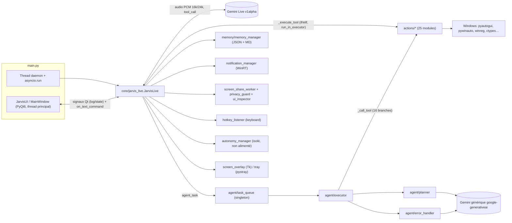
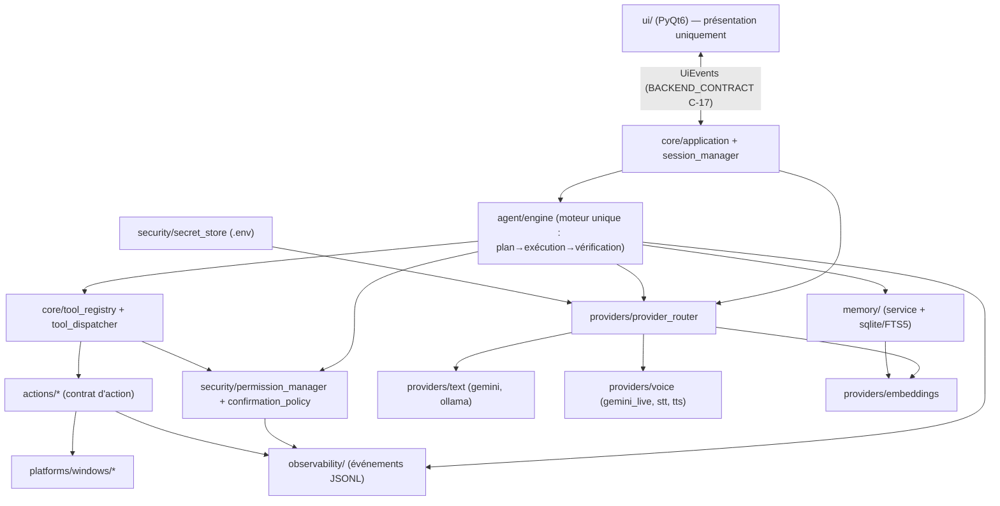
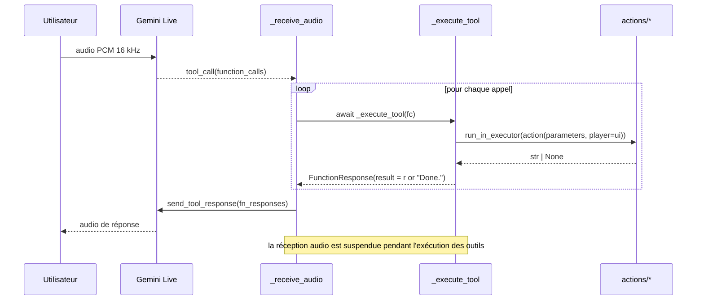
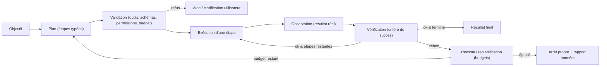

# TRD — JARVIS : Technical Requirements Document

| | |
|---|---|
| **Document** | `TRD.md` (2/9) |
| **Base d'audit** | `main` @ `2dbb971`, lecture statique (aucune exécution) |
| **Lien produit** | `PRD.md` (exigences `V1-*`, `V15-*`) |
| **Lien décisions** | `DECISIONS.md` (ADR-001 à ADR-022) |
| **Lien risques** | `RISKS.md` (`R-O*` observés, `R-F*` futurs) |
| **Légende de statut** | **[ACTUEL]** vérifié dans le code · **[V1]** changement de stabilisation · **[CIBLE V1.5]** architecture proposée, **n'existe pas** · **[V2]** différé |

---

## 1. Inventaire du système actuel [ACTUEL]

### 1.1 Arborescence et responsabilités réelles

```text
main.py                    démarrage : UI Qt (thread principal) + JarvisLive (thread daemon + asyncio)
core/
  jarvis_live.py (817 l.)  session Gemini Live, audio, DISPATCH des 26 outils, boucles de fond, reconnexion
  tools.py       (584 l.)  TOOL_DECLARATIONS (26 dicts de schémas) — aucune logique
  utils.py        (75 l.)  chemins, constantes audio, LIVE_MODEL, _get_api_key(), prompt, nettoyage transcription
  autonomy_manager.py (636) Idea/Agent/AutonomyManager — SIMULATION, non alimenté
  context_engine.py (93)   historique de fenêtres + suggestions — boucle d'appel DÉSACTIVÉE
  action_verifier.py (81)  hash d'écran avant/après
  privacy_guard.py (109)   blocage d'apps/titres + flou de champs mot de passe (screen share seulement)
  screen_share_worker.py   capture diff-based 640x360 JPEG q50
  notification_manager.py  écoute WinRT des toasts Windows, filtrage par app/règles
  hotkey_listener.py (78)  Ctrl+Shift+J « regarde ici »
  file_watcher.py (106)    mode --watch (redémarrage)
  prompt.txt (170)         prompt système « v2.0 »
agent/
  planner.py (270)         plan JSON ≤ 5 étapes via google.generativeai
  executor.py (524)        boucle d'exécution + _call_tool (16 branches) + exécution de code généré + filtre AST
  task_queue.py (220)      file à priorité, max_concurrent=1, thread par tâche, singleton get_queue()
  error_handler.py (198)   décision retry/skip/replan/abort via LLM ; generate_fix()
actions/ (25 modules, ≈10 300 l.)  une fonction d'entrée par outil + utilitaires (image_utils, send_message_utils, browser_inspector, ui_inspector)
memory/
  memory_manager.py (429)  long_term.json + USER_*.md
  config_manager.py (50)   MORT (importé nulle part)
logs/action_logger.py      JSONL d'actions d'interaction écran
ui/
  interface.py (949)       MainWindow, FileDropZone, SetupOverlay, JarvisUI (façade), _RootShim
  hud_canvas.py, metrics.py, screen_overlay.py (Tk), tray_indicator.py (pystray), components/
config/
  __init__.py              get_config()/get_os() lisent config/api_keys.json (plante si absent)
  app_profiles.json, notifications_config.json
```

### 1.2 Couplages réels observés

| # | Couplage | Preuve | Effet |
|---|---|---|---|
| C1 | `core/jarvis_live.py` importe **25 modules** (20 actions, UI, tray, overlay, hotkey, autonomie…) | en-têtes d'import | Dieu-objet ; impossible à tester sans Qt, sounddevice, Windows |
| C2 | Le domaine dépend de l'UI | `from ui import JarvisUI`, `ScreenOverlay`, `TrayIndicator` dans `core/` | Inversion de dépendance cassée |
| C3 | `actions/*` dépendent de `agent` | `from agent.executor import _check_code_safety` dans `code_helper` et `dev_agent` | Cycle potentiel `actions ↔ agent` (masqué par des imports tardifs) |
| C4 | `agent/*` et `actions/*` dépendent de `core.utils._get_api_key` | imports | Clé lue à 6+ endroits |
| C5 | Deux dispatchers d'outils | `JarvisLive._execute_tool` (26) vs `agent/executor._call_tool` (16) | Dérive garantie |
| C6 | Deux déclarations d'outils | `core/tools.py` (modèle Live) vs `PLANNER_PROMPT` (15 outils décrits en texte libre) | Paramètres divergents (ex. `file_controller` : exemple `largest` hors liste d'actions) |
| C7 | Deux SDK Gemini | `google-genai` (Live) vs `google-generativeai` (agent, code_helper, dev_agent, desktop) | Double surface d'API et de dépréciation |
| C8 | Trois chemins de configuration | §2.1 | Cause de panne au premier démarrage |
| C9 | Windows partout | 20+ imports (`winreg`, `ctypes`, `comtypes/pycaw`, `pywinauto`, `pygetwindow`, `win32gui`, `winrt`, `win10toast`) ; 57 branchements `platform.system()/sys.platform/os.name` | Pas de frontière de plateforme |
| C10 | Deux toolkits UI | PyQt6 (fenêtre) + Tkinter (`ScreenOverlay`, un `tk.Tk()` par marqueur, dans des threads) | Fragilité (Tk hors thread principal) |

### 1.3 Diagramme — architecture actuelle (fidèle au code)



### 1.4 Modèle de threads actuel [ACTUEL]

| Thread / boucle | Créé par | Contenu |
|---|---|---|
| Principal | `main.py` | `QApplication.exec()` via `_RootShim.mainloop()` |
| `runner` (daemon) | `main.run_jarvis` | `asyncio.run(JarvisLive.run())`, `TaskGroup` de 6 tâches : `_send_realtime`, `_listen_audio`, `_receive_audio`, `_play_audio`, `_poll_notifications_loop`, `_screen_share_loop` |
| Pool par défaut asyncio | `loop.run_in_executor(None, …)` | Exécution des actions (bloquantes) |
| **Bloquant** | `_receive_audio` fait `await self._execute_tool(fc)` | Pendant un outil long, **aucune réception audio** |
| Callback audio (sounddevice) | PortAudio | `loop.call_soon_threadsafe(out_queue.put_nowait)` ; `out_queue.maxsize=10` → `QueueFull` possible dans le callback |
| `AgentTaskQueue` + `AgentTask-<id>` | `get_queue()` | 1 worker + 1 thread par tâche (`max_concurrent=1`) |
| `screen_process` | `JarvisLive` | `threading.Thread(daemon)` + boucle asyncio propre + seconde session Live |
| `keyboard.wait()` | `HotkeyListener.start()` | **Un nouveau thread à chaque reconnexion** |
| `SysMetrics._loop` | `ui/metrics.py` | Collecte CPU/MEM/NET/GPU/TMP (sous-processus `nvidia-smi`, etc.) |
| `tk.Tk()` éphémères | `ScreenOverlay` | Un thread par marqueur/confirmation |
| `pystray` | `TrayIndicator` | Thread daemon |
| Thread par commande texte | `MainWindow._send` | `on_text_command` lancé dans un thread |
| Watcher (`--watch`) | `main.py` | Thread **non daemon** |

---

## 2. Diagnostic architectural

### 2.1 Défauts structurants (liés à `RISKS.md`)

| ID risque | Défaut | Preuve (fichier:ligne approx.) |
|---|---|---|
| R-O01 | Clé API versionnée en clair | `ui/config/api_keys.json` (2 commits) |
| R-O02 | Clé écrite où le moteur ne la lit pas | `ui/interface.py` l.41-43 vs `core/utils.py` l.15 |
| R-O03 | `.gitignore` ne protège pas le bon fichier | `.gitignore` : `config/api_keys.json` seulement |
| R-O04 | `shell=True` + chaîne issue du modèle | `actions/open_app.py` l.84-97 |
| R-O05 | `exec(compile(code…))` dans le processus | `actions/desktop.py` l.124 ; « sandbox » expose `getattr`, `Path`, `ctypes` |
| R-O06 | Filtre AST contournable et partiel | `agent/executor._check_code_safety` : ne couvre ni `from os import system`, ni `os.popen`, ni `Path.unlink`, ni `.js/.sh/.ps1` |
| R-O07 | Notifications → prompt → `send_message` | `_poll_notifications_loop` |
| R-O08 | Aucune confirmation branchée | `confirm_critical_actions` / `confirm_action` jamais utilisés |
| R-O09 | « Autonomie » fictive | aucun `register_agent`/`submit_idea` hors démo |
| R-O10 | Deux dispatchers | C5 |
| R-O11 | Statut de tâche faux | `task_queue._run_task` |
| R-O12 | Retry/skip/fix incohérents | `error_handler.analyze_error`, `executor` |
| R-O13 | Mémoire : course, écrasement de `.bak`, trim signalé par `print` seulement | `memory_manager` |
| R-O14 | Reconnexion : hotkey dupliquée, outil bloquant la réception, pas de `session_resumption` | `jarvis_live.run` |
| R-O15 | `turn_complete=True` à chaque cycle de partage d'écran | `_screen_share_loop` |
| R-O16 | Filtre de confidentialité non universel | grep `apply_privacy_filter` |
| R-O17 | Texte saisi journalisé | `ActionLogger.log` |
| R-O18 | Profil de navigateur réel + CDP 9222 | `browser_control.py`, `browser_inspector.py` |
| R-O19 | README promet multi-OS | §PRD 3.7 |
| R-O20 | Dépendances incomplètes/dupliquées | §7 |
| R-O21 | Zéro test | — |
| R-O22 | Licence contradictoire | `LICENSE` vs `readme.md` |

### 2.2 Ce qui est sain et doit être préservé

- Décomposition par outil (une fonction d'entrée par action) : bonne base d'un registre.
- `file_controller` : validation de chemin + corbeille + dossiers protégés.
- Écriture atomique de la mémoire (`tmp` → `replace`) et plafonds de taille.
- Reconnexion bornée avec distinction erreurs fatales/transitoires.
- `ScreenShareWorker` : sans thread propre, appelé depuis la boucle ; diff d'image ; filtre de confidentialité.
- Identité visuelle HUD (voir `DESIGN_SYSTEM.md`).
- `ScreenOverlay.confirm_action` : dialogue de confirmation **déjà écrit** (à réutiliser comme repli en V1, puis remplacé en V1.5).

---

## 3. Architecture cible par version

### 3.1 Principes de découpage (anti-cérémonie)

1. On ne crée un module que s'il supprime un couplage **mesuré** en §1.2.
2. Pas de dossier vide : chaque dossier cible apparaît dans la phase qui le remplit.
3. Chemins de compatibilité conservés pendant les migrations (`core/tools.py` continue d'exporter `TOOL_DECLARATIONS`, etc.).
4. Dépendances autorisées (sens unique) :

```text
ui  →  core (application/session)  →  agent  →  actions  →  platforms
                    │                   │          │
                    └──────────────→ memory, security, providers, observability
domaine (agent, memory, security, providers) ne doit JAMAIS importer ui ni PyQt6.
```

### 3.2 Cible V1 — structure minimale [V1]

| Changement | Fichiers (chemins **futurs** sauf mention) | Phase |
|---|---|---|
| Configuration unifiée | `config/settings.py` (nouveau) ; `core/utils.py` délègue ; `config/__init__.py` conservé comme **shim** | P1 |
| `.env.example` | racine (nouveau) | P0/P1 |
| Tests | `tests/unit/`, `tests/fakes/`, `tests/conftest.py`, `pyproject.toml` (**outillage seulement** : pytest/ruff, pas de packaging) | P1.0 (amorce), P2 (complété) |
| Registre + dispatcher | `core/tool_registry.py`, `core/tool_dispatcher.py` ; `core/tools.py` devient une **vue générée** depuis le registre | P3 |
| Découpage Live | `core/session_manager.py` (cycle de vie/reconnexion), `core/audio_io.py` (micro/haut-parleur), `core/background_loops.py` (notifications, partage d'écran) ; `core/jarvis_live.py` réduit à l'orchestration | P4 |
| Tâches | corrections dans `agent/task_queue.py`, `agent/executor.py`, `agent/error_handler.py` | P5 |
| Mémoire | corrections dans `memory/memory_manager.py` (+ `memory/` tests) ; suppression de `memory/config_manager.py` après P1 | P6 |
| Remédiations action | `actions/open_app.py`, `actions/desktop.py`, `core/notification_manager.py`, `logs/action_logger.py`, `config/notifications_config.json` | P7 |
| Tokens UI | `ui/theme.py` (nouveau) importé par `interface.py`, `hud_canvas.py`, `metric_bar.py`, `log_widget.py` | P8 |
| Dépendances | `requirements.txt` restructuré ; `requirements-dev.txt` ; `setup.py` mis à jour | P9 |

### 3.3 Cible V1.5 — arbre proposé, évalué et simplifié [CIBLE V1.5]

L'arbre fourni dans la mission est repris avec les **écarts justifiés** suivants (consignés dans `DECISIONS.md`) :

| Élément de l'arbre proposé | Décision | Justification |
|---|---|---|
| `platform/windows/` | **Renommé `platforms/windows/`** | Un paquet racine `platform/` **masque le module standard `platform`** (importé par `ui/interface.py`, `actions/*`, etc.) quand l'application est lancée depuis la racine ⇒ erreurs d'import. ADR-010 |
| `perception/` (audio_stream, screen_capture, window_context) | **Différé** : créé en P12 (audio) et P16 (écran/fenêtre) seulement | « Extraction progressive » : on déplace `core/screen_share_worker.py` + `actions/ui_inspector.py` quand les actions de contrôle sont migrées |
| `observability/action_logger.py` | Créé en P13 ; `logs/action_logger.py` devient shim | `logs/` est aujourd'hui aussi le dossier des artefacts runtime (`logs/*.log`, `*.jsonl`) |
| `security/privacy_guard.py` | Déplacé depuis `core/` en P13, shim conservé | Le garde-fou devient universel (V1.5) |
| `agent/autonomy_manager.py` « unifié » | **Le fichier `core/autonomy_manager.py` actuel est supprimé** ; l'autonomie unifiée vit dans `agent/engine.py` + `agent/autonomy_manager.py` (nouveau contenu) | Un seul moteur (ADR-007) ; le contenu actuel est une simulation |
| `memory/json_store.py`, `memory/models.py`, `retrieval.py`, `document_ingestion.py`, `embeddings.py` | Conservés, mais `embeddings.py` **délègue** au contrat `providers/embeddings` | Séparation stockage / récupération / fournisseur d'embeddings |
| `pyproject.toml` | Packaging introduit en **P10** (extras `local`, `rag`, `windows`) ; en V1 seulement l'outillage (amorce P1.0) | ADR-018 |
| `core/application.py` | Créé en P4 (composition, cycle de vie) | Remplace la composition implicite de `JarvisLive.__init__` |

```text
jarvis/                                   (cible V1.5 — chemins futurs)
├── main.py
├── pyproject.toml
├── requirements.txt / requirements-dev.txt
├── .env.example
├── core/       application.py · session_manager.py · tool_registry.py · tool_dispatcher.py
│               audio_io.py · background_loops.py · context_engine.py · notification_manager.py
├── providers/  base.py · capabilities.py · provider_registry.py · provider_router.py
│   ├── text/   base.py · gemini.py · ollama.py
│   ├── voice/  realtime_base.py · gemini_live.py · stt_base.py · tts_base.py · (stt_whisper.py · tts_piper.py : optionnels)
│   └── embeddings/ base.py · local.py
├── perception/ audio_stream.py · screen_capture.py · window_context.py        (P12 / P16)
├── security/   secret_store.py · permission_manager.py · confirmation_policy.py · privacy_guard.py
├── actions/    base.py · schemas.py · <26 outils migrés>
├── agent/      models.py · planner.py · executor.py · engine.py · task_store.py · error_handler.py · autonomy_manager.py
├── memory/     memory_manager.py · json_store.py · models.py · sqlite_store.py · retrieval.py · document_ingestion.py · embeddings.py
├── platforms/windows/                    adaptateurs (registre, volume, notifications, fenêtres, planification)
├── ui/         interface.py · theme.py · hud_canvas.py · screen_overlay.py · tray_indicator.py · components/ · dialogs/
├── observability/ events.py · action_logger.py
├── config/     settings.py · app_profiles.json · notifications_config.json
└── tests/      unit/ · contracts/ · integration/ · ui/ · fakes/
```

### 3.4 Diagramme — architecture cible V1.5 [CIBLE V1.5]



---

## 4. Flux d'exécution principaux

### 4.1 Appel d'outil par la voix [ACTUEL]



### 4.2 Appel d'outil [V1] (cible P3–P4)

Mêmes acteurs, mais : `_receive_audio` **planifie** l'exécution (`asyncio.create_task`) et renvoie les réponses d'outils dès qu'elles sont prêtes ; le dispatcher `core/tool_dispatcher.py` applique : validation des paramètres (schéma du registre) → exécution (exécuteur de threads borné, délai) → normalisation en `ToolResult` (`BACKEND_SCHEMA.md` §2) → réponse au modèle. **Aucune** réponse « Done. » par défaut : le résultat porte un statut explicite (`ok`, `unverified`, `error`).

### 4.3 Boucle agent [CIBLE V1.5]



---

## 5. Concurrence, threads et boucles asynchrones

### 5.1 Règles [V1 → V1.5]

| Règle | V1 | V1.5 |
|---|---|---|
| Une seule boucle `asyncio` propriétaire des E/S du provider vocal | ✅ (déjà le cas pour `JarvisLive`) ; `screen_process` conserve sa boucle isolée (documenté) | Fusion : un seul adaptateur vocal ; `screen_process` utilise le provider vision/vocal via le routeur |
| La boucle de réception ne bloque pas | Exécution d'outils en tâches séparées (P4) | Moteur de tâches annulables |
| UI uniquement via signaux/événements | ✅ existant (`_log_sig`, `_state_sig`) | `UiEvents` formalisés (C-17) |
| Une seule instance d'écouteur de raccourci | `start()` idempotent ; arrêt à la fermeture (P4) | Géré par `application` |
| Tk hors thread principal | Documenté, conservé | Remplacement par un overlay Qt (proposé, ADR-021) |
| `queue.maxsize=10` du micro | Politique « abandonner le plus ancien » documentée et testée | idem, métrique |
| Arrêt | `shutdown_jarvis` : arrêt coopératif (annulation des tâches, fermeture de session) avec repli `os._exit` après délai | `application.shutdown()` |

### 5.2 Annulation et délais

- Chaque exécution d'outil reçoit un `CancelToken` (V1.5) ; en V1, annulation coopérative limitée à `TaskQueue` (drapeau `cancel_flag` déjà présent).
- Délais par outil : valeur par défaut du registre (ex. 30 s) surchargeable ; dépassement ⇒ `ErrorCode.TIMEOUT` (jamais de blocage indéfini).

---

## 6. Configuration, secrets et stockage des données

### 6.1 Chemins [V1, P1]

| Donnée | Développement | Application installée/gelée |
|---|---|---|
| Secrets | `<racine>/.env` | `%APPDATA%\Jarvis\.env` |
| Paramètres non secrets | `<racine>/config/settings.json` (+ `app_profiles.json`, `notifications_config.json`) | `%APPDATA%\Jarvis\config\` |
| Mémoire | `<racine>/memory/` (ignorée par Git) | `%APPDATA%\Jarvis\memory\` (V1.5 : `memory.db`) |
| Journaux | `<racine>/logs/` | `%LOCALAPPDATA%\Jarvis\logs\` |
| Projets générés (`dev_agent`) | `~/Desktop/JarvisProjects` (inchangé en V1) | idem ; V1.5 : espace de travail configurable |

> Aujourd'hui `get_base_dir()` est **recopiée** dans ≥ 8 modules (`core/utils`, `memory/*`, `agent/*`, `ui/interface`, `actions/*`) avec des résultats **différents** (`ui/` vs racine). P1 la centralise dans `config/settings.py` (`paths`).

### 6.2 Priorité de chargement des secrets [V1]

1. Variable d'environnement du processus (`GEMINI_API_KEY`) ;
2. `.env` du profil utilisateur (application installée) ;
3. `.env` à la racine du projet (développement) ;
4. sinon : état « non configuré » → dialogue masqué (UI) ou message actionnable (CLI/tests).

Règles : un seul chargeur ; **réécriture ciblée** d'une clé sans supprimer les autres lignes du `.env` (lecture → remplacement/ajout de la ligne → écriture atomique) ; permissions restrictives sur Windows en **meilleur effort** (`icacls`) ; `.env.example` ne contient que des noms et des valeurs factices ; rotation = remplacement de la ligne ; effacement = suppression de la ligne (UI « Supprimer la clé »).

**Limite assumée** : le `.env` est une **configuration locale en clair**, pas un coffre chiffré ; il protège contre la fuite via Git, pas contre un processus local malveillant. Un adaptateur Windows Credential Manager est prévu en V1.5 (facultatif), jamais obligatoire.

### 6.3 Paramètres non secrets

`config/settings.json` : `os_system`, `provider.mode` (V1.5), niveau d'autonomie (V1.5), chemins surchargés. **Jamais** de clé. `os_system` quitte `api_keys.json` (champ aujourd'hui lu par 6 modules).

### 6.4 Compatibilité descendante

Pendant P1, `config/__init__.get_config()` reste disponible et lit `settings.json` (avec repli sur l'ancien `api_keys.json` **pour `os_system` uniquement**, avec avertissement), afin de ne pas casser `flight_finder`, `game_updater`, `youtube_video`.

---

## 7. Dépendances et installation

### 7.1 Constat (analyse AST des imports vs `requirements.txt`)

| Problème | Détail |
|---|---|
| **Imports sans déclaration** | `PyPDF2`, `pdfplumber`, `python-docx` (`docx`), `pandas`, `gtts`, `pyttsx3`, `pywin32` (`win32gui`, `win32process`), `ddgs` (alias récent de `duckduckgo_search`) |
| **Déclarées mais non importées** | `beautifulsoup4` |
| **Doublons** | `pillow` et `Pillow` |
| **Deux SDK Gemini** | `google-genai` et `google-generativeai` |
| **Aucune version épinglée** | 32 lignes sans contrainte |
| **Dépendances Windows non marquées** | `comtypes`, `pycaw`, `win10toast`, `pywinauto`, `pygetwindow`, `winrt-*` sans marqueur d'environnement |
| **README** | « some OS-specific dependencies are not bundled » — reconnaît le défaut |

### 7.2 Cible [V1, P9]

- `requirements.txt` : cœur + Windows avec marqueurs (`; sys_platform == "win32"`) ; `requirements-optional.txt` (documents, TTS de message) ; `requirements-dev.txt` (pytest, ruff, …).
- **Versions** : ne pas inventer ; P9 exécute l'installation sur venv vierge Windows 10/11, relève les versions résolues, et n'épingle (`==`/`~=`) que celles **vérifiées** par la suite de tests et un démarrage manuel.
- `google-generativeai` : maintenu en V1 (usage existant), **migration vers `google-genai`** planifiée en P10 (provider texte Gemini). Statut de support du SDK hérité à confirmer au moment de P10.
- `setup.py` actuel (pip + `playwright install`) : conservé et corrigé ; message final cohérent (« MARK XXXIX »).

---

## 8. Journalisation et gestion d'erreurs

### 8.1 État actuel

`print` généralisé (emoji, pas de niveaux) ; `logging.basicConfig(INFO)` exécuté **à l'import** de `core/autonomy_manager.py` (effet de bord global) ; `ActionLogger` JSONL pour `interact_ui` seulement ; erreurs d'outils : exception → chaîne `"Tool 'x' failed: …"` + `speak_error` (vocalise un message d'erreur de 120 caractères).

### 8.2 Cible

| Version | Exigence |
|---|---|
| V1 | Retirer l'effet de bord `basicConfig` ; module `logging` standard avec un point de configuration unique ; événements d'outils (`tool.start`, `tool.end`, `tool.error`) en JSONL **sans valeurs de paramètres sensibles** (liste de champs masqués : `content`, `message_text`, `value`, `text` des actions `type`) ; messages d'erreur vocalisés sans chemins ni secrets |
| V1.5 | `observability/events.py` : schéma d'événements (`BACKEND_SCHEMA.md` §AuditEvent), identifiants de tâche/étape/outil, durée, statut de vérification, décisions de permission ; rotation ; export lisible |

### 8.3 Taxonomie d'erreurs (commune V1/V1.5)

`CONFIG_MISSING, AUTH_FAILED, PROVIDER_UNAVAILABLE, NETWORK_DOWN, CAPABILITY_MISSING, RATE_LIMITED, VALIDATION_FAILED, PERMISSION_DENIED, CONFIRMATION_DECLINED, TIMEOUT, CANCELLED, PLATFORM_UNSUPPORTED, DEPENDENCY_MISSING, ACTION_FAILED, VERIFICATION_FAILED, BUDGET_EXCEEDED, INTERNAL` (définition normative : `BACKEND_SCHEMA.md` §ErrorCode). Règle : une action ne retourne **jamais** « succès » sans statut de vérification (`verified | unverified | not_applicable`).

---

## 9. Stratégie de test

### 9.1 Pyramide

| Couche | Contenu | Réseau/secret | Marqueur pytest |
|---|---|---|---|
| Unitaire | mémoire, configuration, file de tâches, planificateur (parsing), registre d'outils, validation de chemins, filtre de confidentialité | ❌ / ❌ | (défaut) |
| Contrats | chaque faux provider/outil respecte le contrat ; `déclaration ⇔ handler` pour 26 outils ; instantané de `TOOL_DECLARATIONS` | ❌ / ❌ | `contract` |
| Architecture | AST : pas de `PyQt6` dans domaine ; pas de `google.*` hors `providers/` (V1.5) ; pas de `winreg/ctypes/pycaw/pywinauto/winrt` hors `platforms/` (V1.5) | ❌ / ❌ | `architecture` |
| UI | `pytest-qt` en mode offscreen : démarrage, états HUD, dialogue de clé, F4/F11 | ❌ / ❌ | `ui` |
| Intégration provider | Gemini Live réel, Ollama réel (si installé) | ✅ / ✅ **opt-in** | `integration` (désactivé par défaut) |
| Actions à effets de bord | sur répertoire temporaire et applications factices ; **jamais** sur le vrai bureau par défaut | ❌ | `sidefx` (Windows) |
| Régression migration | mémoire JSON→SQLite, config ancienne→nouvelle, aller-retour | ❌ | `migration` |

### 9.2 Garde-fous techniques

- `tests/conftest.py` bloque `socket.socket.connect` (échec explicite) sauf marqueur `integration`.
- Remplacements (`tests/fakes/`) : `FakeLiveSession` (rejoue des `server_content`/`tool_call`), `FakeTextProvider`, `FakeClock`, `FakeActionRegistry`, `FakeFilesystem` (tmp_path), `FakePlatform`.
- **Les modules qui importent `sounddevice`, `pyautogui`, `keyboard`, `PyQt6` à l'import** doivent être importables en mode test (imports tardifs ou fakes injectés) — critère de P4.
- Jeux de données **synthétiques** uniquement ; jamais de vraie mémoire ni de capture réelle.
- CI proposée (fichier **futur**, P9) : GitHub Actions `windows-latest` pour la suite par défaut ; aucun secret dans le workflow.

---

## 10. Sécurité et limites d'exécution

### 10.1 Modèle de menace synthétique

| Actif | Menace | Contrôle V1 | Contrôle V1.5 |
|---|---|---|---|
| Clé API | fuite Git/logs/captures | P0/P1, masquage des logs | `secret_store`, détection de secrets dans les sorties |
| Fichiers utilisateur | écriture/suppression par le modèle | existant (`_is_safe_path`, corbeille) + restriction documentée | répertoires autorisés configurables ; confirmation des écritures hors espace de travail |
| Messages externes | envoi non voulu, injection par notification | `auto_reply_enabled=false` ; confirmation minimale | confirmation selon niveau d'autonomie ; contenu entrant étiqueté `untrusted` |
| Processus/système | `kill_process`, `computer_settings` (alimentation, réseau) | `dry_run` recommandé + confirmation minimale | niveau de risque `HIGH` → confirmation obligatoire |
| Code généré | exécution arbitraire | suppression de `exec` in-process ; sous-processus ; extension de la liste de contrôle à tous les langages **ou** désactivation | espace de travail explicite, outils d'exécution contrôlés, réseau désactivable ; **un filtre AST n'est jamais présenté comme une garantie** |
| Écran/audio | capture de données sensibles | filtre de confidentialité étendu aux captures hors partage d'écran | filtre universel dans `perception/` |
| Navigateur | accès aux sessions du profil réel | documenter ; option profil dédié par défaut | profil dédié obligatoire par défaut ; domaines sensibles bloqués |

### 10.2 Limites d'exécution (valeurs initiales proposées, à calibrer)

Plan ≤ 5 étapes en V1 (existant) ; ≤ 12 en V1.5 ; 3 tentatives par étape ; 2 replanifications ; délai d'étape 60 s (code : 30 s existant) ; plafond d'appels modèle par tâche (V1.5, configurable) ; un seul `agent_task` actif en V1 (existant) ; limite de caractères de sortie d'outil renvoyée au modèle (ex. 4 000, comme `read_file`).

### 10.3 Contenus non fiables

Tout contenu venant d'une page web, d'un message, d'un fichier importé, d'une notification ou d'une sortie d'outil est encapsulé (`<untrusted source="…">…</untrusted>` dans les tours envoyés au modèle) et **ne peut pas** modifier permissions, niveau d'autonomie, liste d'outils ou configuration. Les actions déclenchées à la suite d'un tel contenu passent par la confirmation (V1.5) ; en V1 la réponse automatique est coupée par défaut.

---

## 11. Compatibilité Windows

### 11.1 Périmètre supporté

| Version | Support |
|---|---|
| V1 | **Windows 10/11 uniquement** (testé). macOS/Linux : code présent par endroits, **non supporté, non testé** |
| V1.5 | Windows ; frontières `platforms/windows/` ; interfaces stables |
| V2 | Autres OS candidats, avec tests réels |

### 11.2 Dépendances Windows relevées (à isoler en V1.5)

`winreg` (browser_control, computer_settings, desktop, game_updater, executor) · `ctypes`+`comtypes`+`pycaw` (volume) · `pywinauto`+`win32gui`+`win32process` (ui_inspector, game_updater) · `pygetwindow` · `winrt-*` (notifications) · `win10toast` + `schtasks` (rappels) · `keyboard` (raccourci global ; privilèges potentiellement requis) · `send2trash` (corbeille).

### 11.3 Contrats d'adaptateur (V1.5)

`platforms/windows/` expose : `volume`, `brightness`, `wifi`, `power`, `registry_read`, `windows_list/active`, `notifications_listener`, `scheduler` (rappels), `toast`, `trash`, `open_application`. Les actions appellent ces interfaces ; elles ne connaissent pas Windows. Détails : `BACKEND_CONTRACT.md` C-18.

---

## 12. Points d'extension (V2)

- **Autres OS** : implémenter les contrats `platforms/<os>/` ; test de contrat commun.
- **Client web / séparation client-moteur** : le moteur n'expose que des événements (`UiEvents`, C-17) et des commandes sérialisables ; `ui/` n'est jamais importé par le moteur ; le transport (IPC/WebSocket) est **hors périmètre** V1/V1.5.
- **Nouveaux providers** : ajout d'un adaptateur + déclaration de capacités.
- **Mémoire** : nouveaux extracteurs de faits, graphes — sans changer les contrats de recherche.

---

## 13. Stratégie de migration depuis le code actuel

### 13.1 Méthode (« étrangler » plutôt que réécrire)

1. **Figer le comportement** : instantané `TOOL_DECLARATIONS`, scénarios de référence manuels (voix, texte, 5 outils représentatifs), copie de sauvegarde des données utilisateur.
2. **Introduire le nouveau module derrière un shim** (ancienne API conservée).
3. **Basculer les appelants un par un**, avec test de caractérisation avant/après.
4. **Supprimer le shim** seulement quand plus aucune référence (recherche statique) et après la gate de phase.
5. Un commit = une intention ; retour arrière = `git revert` du lot, plus restauration des données si une migration de données est impliquée.

### 13.2 Ordre imposé (détail : `DEVELOPMENT_PHASES.md`)

`P0 secrets → P1 config → P2 tests → P3 registre/dispatcher → P4 découpage Live → P5 tâches → P6 mémoire → P7 remédiations → P8 UI → P9 gate V1` puis `P10 providers → P11 texte local/routeur → P12 voix → P13 sécurité → P14 contrat d'action → P15 moteur unique → P16 contrôle ordinateur → P17 service mémoire → P18 RAG → P19 UI/intégration/gate V1.5`.

### 13.3 Compatibilité des contrats d'outils (V1)

Les 26 noms et les paramètres de `core/tools.py` sont conservés **à l'identique**. Changements autorisés et documentés : (a) `manage_autonomy` : description marquant la fonction « expérimentale, sans effet autonome » ; (b) `save_memory` : validation de catégorie (valeurs hors liste → `notes` ou erreur explicite, à trancher en P6 et consigner) ; (c) `prompt.txt` : corriger la mention `memory_write` → `save_memory`.

---

## 14. Questions techniques ouvertes

| # | Question | Qui/quand |
|---|---|---|
| Q1 | `v1alpha` vs `v1beta` pour Gemini Live, et `session_resumption` | test d'intégration opt-in, P4/P10 |
| Q2 | Comportement réel des actions non approfondies (`game_updater`, `flight_finder`, `youtube_video`, `weather_report`, `file_processor`) | revue détaillée au début de P3 (inventaire d'outils) |
| Q3 | Faisabilité des modèles locaux sur le matériel du propriétaire (RAM/GPU) | mesure en P11/P12 |
| Q4 | Besoin réel d'un vectoriel (ou FTS5 seul suffit) | mesure de pertinence en P18 |
| Q5 | Windows Credential Manager : valeur ajoutée vs complexité | décision différée (ADR-006) |
